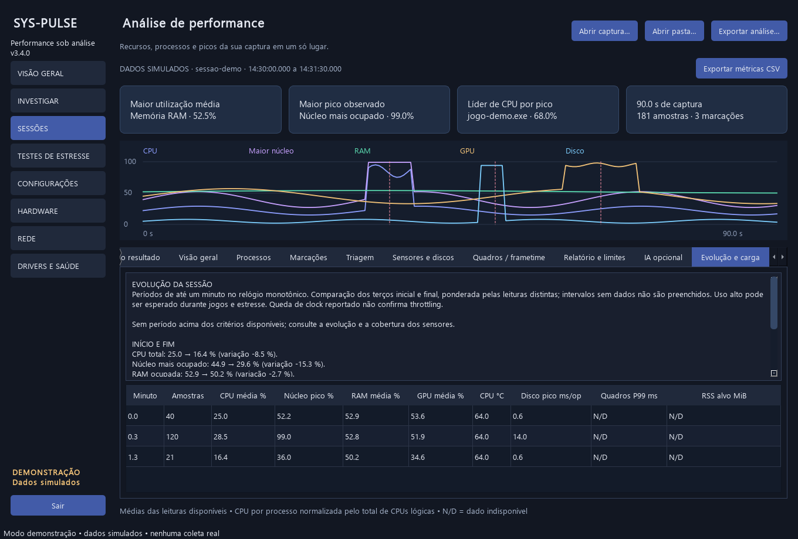
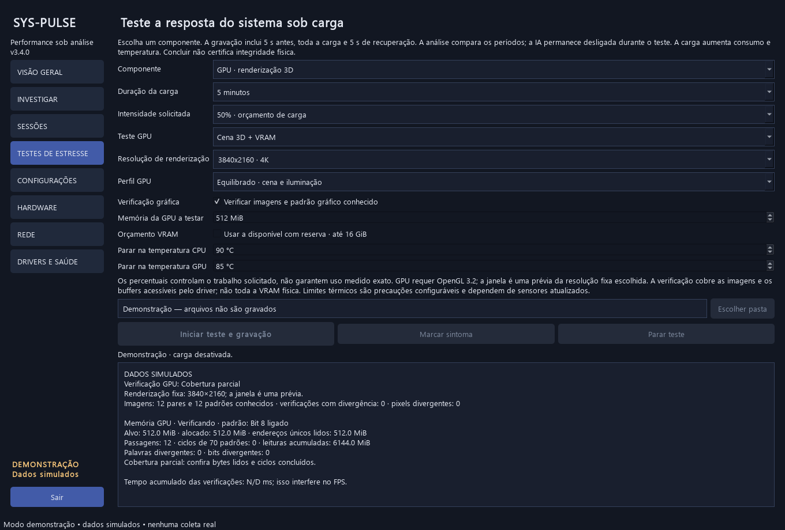
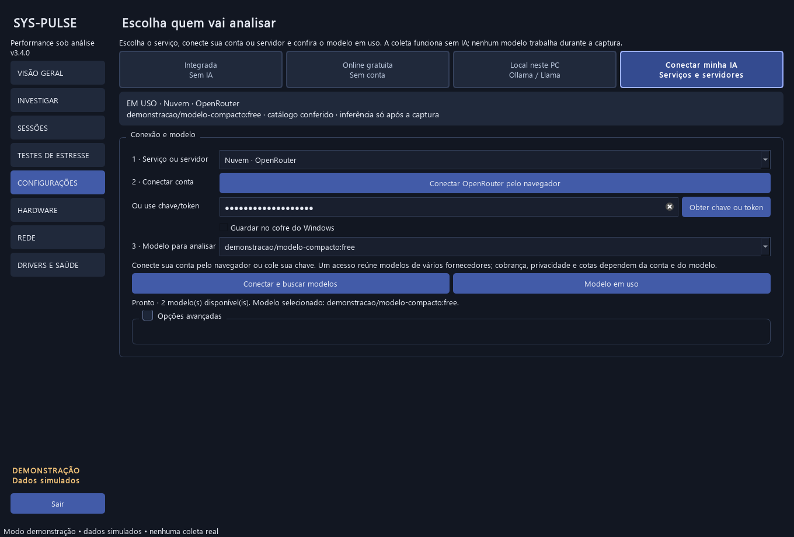
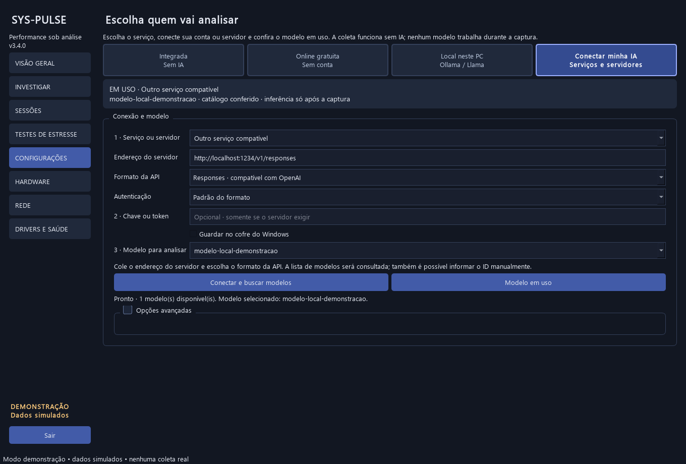

# SysPulse 3.4

**Grave o desempenho, marque o sintoma e investigue as evidências.**

Aplicativo desktop em Python e PySide6 para acompanhar CPU, memória, GPU, discos e rede. A análise local funciona sem conta, internet ou modelo de IA. A integração opcional com IA só trabalha depois da captura.


Os prints e a sessão de demonstração usam **dados simulados**, identificados na interface.

## Downloads

**[Baixar os instaladores no GitHub Releases](https://github.com/Kennedh/sys-pulse/releases/latest)** · [Todos os downloads](https://github.com/Kennedh/sys-pulse/releases) · [Guia de instalação](docs/downloads.md)

Os arquivos ficam em **Releases → Assets** no GitHub. Modelos de IA não acompanham o instalador.

| Sistema | Arquivo da versão 3.4 | Instalação |
|---|---|---|
| Windows x64 | [Setup.exe](https://github.com/Kennedh/sys-pulse/releases/download/v3.4.0/SysPulse-3.4.0-Windows-x64-Setup.exe) | Escolha a pasta, os atalhos e como preparar a análise. Inclui desinstalador. |
| Linux x64 | [Setup.run](https://github.com/Kennedh/sys-pulse/releases/download/v3.4.0/SysPulse-3.4.0-Linux-x64-Setup.run) | Escolha uma pasta exclusiva. Não precisa de root ao instalar na pasta do usuário. |
| macOS Apple Silicon | [Setup.pkg](https://github.com/Kennedh/sys-pulse/releases/download/v3.4.0/SysPulse-3.4.0-macOS-arm64-Setup.pkg) | Instalador nativo, com destino padrão em Aplicativos. |
| macOS Intel | [Setup.pkg](https://github.com/Kennedh/sys-pulse/releases/download/v3.4.0/SysPulse-3.4.0-macOS-x64-Setup.pkg) | Instalador nativo para Intel. |

A seção Assets também oferece ZIP portátil no Windows, TAR.GZ no Linux, DMG no macOS e SHA256SUMS.txt para conferir a integridade. No DMG, arraste o aplicativo para a pasta desejada. A disponibilidade de cada arquivo depende de seu build nativo concluir com sucesso.

Windows usa Python e Qt empacotados. No Linux, bibliotecas gráficas do sistema continuam necessárias; a base de build é Ubuntu 22.04. O pacote macOS declara mínimo de macOS 13; o Ollama atual tem requisitos próprios, incluindo macOS 14 ou superior. Consulte o [guia por sistema](docs/downloads.md).

Os pacotes ainda não possuem certificado comercial de assinatura nem notarização Apple. Confira a origem e o SHA-256. O sistema pode exibir aviso de editor não verificado.

## Instalar e começar

Não precisa instalar Python para usar os pacotes. Na primeira abertura, escolha **Análise integrada**, **IA local** ou **IA anônima na nuvem**. Essa escolha não inicia download ou inferência; as opções ficam disponíveis em Configurações.

No projeto, iniciar.bat abre dist/SysPulse/SysPulse.exe ou o ambiente Python local.

1. Aguarde a consulta inicial do inventário.
2. Abra **INVESTIGAR**, escolha a tarefa e mantenha **Leve · acompanhe a sessão inteira** para começar.
3. Escolha o aplicativo se quiser acompanhar um processo específico. Para quadros, selecione o processo que realmente apresenta a imagem.
4. Clique em **Iniciar** e use o computador. Ao perceber o sintoma, use **Marcar** ou **Ctrl + Alt + F8**.
5. Aguarde pelo menos cinco segundos após a última marcação e clique em **Encerrar**. A análise abre automaticamente.
6. Comece pela explicação. Confira recursos, processos, marcações e quadros nas tabelas de evidências.

Fechar a janela minimiza para a bandeja quando disponível. Use **Sair** para finalizar o aplicativo. Confira antes de jogar se o atalho global foi registrado e funciona no seu ambiente.


## Escolher a captura

| Modo | Uso | Dados e limites |
|---|---|---|
| Leve | Trabalhar, jogar ou acompanhar uma tarefa por mais tempo | Recursos contínuos, processo escolhido, marcações e relatório. Duração de 15, 30, 60 ou 120 minutos; padrão de 30 minutos. |
| Detalhada · próximo sintoma | Aguardar uma pausa difícil de reproduzir | Recursos contínuos e WPR circular em memória. A primeira marcação solicita o salvamento após mais cinco segundos. O ETL preserva eventos recentes; partes antigas podem ser sobrescritas. |
| Detalhada · reprodução curta | Reproduzir o problema em poucos minutos | WPR em arquivo, até três minutos e limite aproximado de 1 GiB temporário. |

O modo circular reserva aproximadamente **128 MiB para buffers do kernel**, além dos recursos do WPR. O ETL salvo tem tamanho variável. Não equivale a registrar todos os eventos detalhados de uma partida inteira.

As capturas WPR solicitam administrador pelo UAC apenas para o auxiliar. O software controla sua própria instância. Para processar ETL, instale o [Windows Performance Toolkit](https://learn.microsoft.com/en-us/windows-hardware/test/wpt/) com Xperf. A coleta nativa funciona sem ele.

**Mais opções** reúne intervalo, pasta, sensores extras, PresentMon e acesso ao ETL. A interface impede capturas simultâneas e análise por IA durante uma gravação.

## Sessões longas de jogos e cargas

Use o modo leve para gravar a partida inteira pelo tempo escolhido. Não é necessário encurtar a tarefa nem marcar um sintoma para analisar a evolução.

A aba **Evolução e carga** mostra períodos de até um minuto, com CPU, núcleo mais ocupado, RAM, GPU, temperatura, latência de disco, frametime P99 quando disponível e RSS do aplicativo escolhido. O relatório destaca até cinco períodos acima dos critérios de triagem e compara os terços inicial e final da sessão.

Sensores e processos em cache são deduplicados quando possuem identificador de leitura. Lacunas não são preenchidas. Períodos iniciais e finais podem ser parciais. Uso elevado é esperado em vários jogos e testes; não comprova gargalo ou defeito. Variação de RSS não confirma vazamento e queda de frequência reportada não confirma throttling.



## Testes de estresse

Abra **TESTES DE ESTRESSE**, escolha componente, duração e intensidade solicitada. A gravação começa automaticamente, registra cinco segundos de linha de base, acompanha toda a carga e mantém cinco segundos de recuperação. O resultado abre em Sessões.

| Teste | O que executa | Limite |
|---|---|---|
| CPU | Processos separados com PBKDF2-SHA256 e verificação de um resultado conhecido | Não cobre todas as instruções, caches ou modos de falha do processador. |
| GPU 3D | 84 cubos em movimento, perspectiva, profundidade e iluminação. Resolução fixa HD/Full HD/QHD/4K ou personalizada; FPS e frametime P95/P99. Verificação opcional das imagens e de um padrão conhecido. | Artefatos idênticos nas duas imagens podem passar. O driver escolhe o adaptador. |
| VRAM | Escrita pela GPU, leitura integral dos buffers pela CPU e comparação com 70 padrões; pode ser combinada com a cena 3D. | Cobre a alocação acessível pelo driver, com reserva para o sistema. Não verifica toda a VRAM física ou áreas reservadas. |
| RAM | Escrita/leitura dos padrões 0xAA/0x55 em blocos de 1 MiB | Verifica somente a alocação virtual escolhida, até 25% da RAM disponível; não substitui MemTest. |

A duração da carga pode ser 5, 15, 30 ou 60 minutos. A intensidade é um orçamento de trabalho, não uma promessa de utilização exata. O padrão CPU usa até 64 processos lógicos disponíveis e 50% do orçamento por processo; é possível ajustar.

**Parar teste** encerra a carga e preserva a recuperação. **Marcar sintoma** ou Ctrl+Alt+F8 registra uma percepção real; fases automáticas não são tratadas como sintomas.

Os limites configuráveis de temperatura começam em 90 °C para CPU e 85 °C para GPU. Eles são precauções, não limites universais de hardware. A parada depende de sensores atualizados; sem leitura correspondente, ela não pode ser verificada. O teste também solicita parada quando o monitor perde atualização ou há pouca RAM disponível.

Mantenha a janela GPU visível. Renderização por software é recusada. Fechar a janela interrompe o teste. A IA e outros modos de captura ficam bloqueados durante a sessão.

Concluir sem divergências não certifica estabilidade física. Teste interrompido, falha de processo e ausência de verificação GPU aparecem separados de uma conclusão normal. Os parâmetros, limites, leituras térmicas e resultados ficam em stress.json junto à sessão.

### Configurar o teste de GPU

1. Escolha **GPU** e o modo: **Cena 3D**, **VRAM · escrita e leitura** ou **Cena 3D + VRAM**.
2. Na cena, selecione HD, Full HD, QHD ou 4K. Para outra resolução, digite largura×altura, como 3440x1440. O limite é 16.777.216 pixels, com até 8192 por dimensão; 8K não é aceito.
3. Mantenha **Verificar imagens e padrão gráfico conhecido** para comparar duas renderizações do mesmo instante e um padrão calculado independentemente na CPU.
4. Na VRAM, escolha o orçamento em MiB ou **Usar a disponível com reserva**. O automático reserva pelo menos 512 MiB ou 15% da memória livre informada e limita a alocação a 16 GiB. Sem informação do driver, usa um limite conservador de até 512 MiB e 10% da RAM livre.
5. Acompanhe passagens, ciclos, bytes únicos lidos e divergências. Um ciclo reúne os 70 padrões. **Cobertura completa** exige ler todo o orçamento efetivo e concluir pelo menos um ciclo.

A resolução é renderizada em um framebuffer fixo; redimensionar a janela ou usar escala de tela não muda o teste. A janela exibe uma prévia. Na verificação exclusiva de VRAM, essa prévia é leve e seus FPS não são apresentados como desempenho do teste de memória.

Os padrões de memória incluem zeros, uns, 0xAA/0x55, endereços, inversos e bits móveis. Os endereços são lógicos: o driver pode paginar buffers ou usar memória compartilhada. O orçamento efetivo pode ser menor que o solicitado para preservar a reserva. Um resultado sem erros não comprova a integridade de áreas que não foram verificadas.

Ao detectar divergência, a carga solicita parada e preserva contadores e exemplos. Divergência de imagem salva até duas PNGs de evidência na pasta auxiliar indicada pelo relatório. Verificações normais não gravam vídeo nem uma imagem por quadro. A leitura de buffers e imagens aumenta CPU, tráfego e frametime; o relatório informa esse custo. Compare desempenho apenas com os mesmos parâmetros.



## Quadros e frametimes

Ao investigar imagem engasgando, habilite a captura de quadros e selecione o aplicativo. O pacote gerado com a ferramenta local inclui o [PresentMon](https://github.com/GameTechDev/PresentMon); no código-fonte, informe o executável em Mais opções ou disponibilize-o no PATH.

O modo de coleta mínimo registra os intervalos produzidos pelo aplicativo, separados por PID e swapchain. Durante a captura, o cartão mostra FPS produzidos e frametime P95/P99 da cadeia com mais quadros na janela recente, atualizado a cada dois segundos. A análise final mostra FPS, mediana, P95, P99, máximo, intervalos longos e recursos observados perto dos maiores eventos. São usados QPC e relógio monotônico para essa associação.

Esse modo não registra latência de entrada, tempo efetivamente exibido ou ocupação da GPU por quadro. Inicialização, minimização e limitadores também podem produzir intervalos longos. Os dados mostram o evento; isoladamente, não confirmam sua causa.

Os frametimes são comprimidos ao encerrar. Um limite aproximado de 256 MiB no CSV interrompe essa coleta, mantendo os recursos nativos. Ausência de suporte, permissão ou quadros aparece como aviso.

## Hardware, visão geral e rede

- **Visão geral:** cartões de CPU, RAM, GPU, disco, temperaturas e custo da coleta; histórico e detalhes.
- **Hardware:** processador, placa-mãe, BIOS, módulos de RAM, discos, GPU, driver gráfico, frequência de atualização informada e plano de energia.
- **Rede:** interfaces, endereços, máscara, MTU, tráfego, destino de ping configurável, respostas, timeouts e variação entre respostas.
- **Drivers e saúde:** inventário PnP, armazenamento e eventos do Windows, consulta de ofertas de drivers pelo Windows Update e integração opcional com LatencyMon.


A disponibilidade depende do hardware, driver e permissões. N/D significa ausência de informação. Ping ao destino escolhido não representa automaticamente a latência de um jogo. Sem resposta ICMP não comprova perda de pacotes do aplicativo.

Temperatura, clock efetivo, configuração de canais de memória, saúde SMART/NVMe completa e integridade física não estão garantidos por essas consultas. O software não altera clocks, tensões, drivers ou planos de energia.

Sensores extras podem ser lidos do [LibreHardwareMonitor](https://github.com/LibreHardwareMonitor/LibreHardwareMonitor) em http://127.0.0.1:8085/data.json. Ative seu servidor local e a opção correspondente em Mais opções. NVIDIA também usa NVML quando disponível.

## Drivers, atualizações e LatencyMon

Em **DRIVERS E SAÚDE → Atualizações e LatencyMon**, use **Consultar atualizações de drivers**. A consulta informa ofertas aplicáveis do Windows Update; não instala nada e bloqueia novas capturas enquanto consulta. Sem ofertas não prova que a versão mais recente do fabricante está instalada. Use **Instalar pelo Windows Update** ou o link oficial do fabricante para revisar e instalar.

O instalador Windows oferece uma opção para preparar o LatencyMon após instalar o SysPulse. Também é possível instalar depois, pela mesma tela:

1. **Baixar e abrir instalador oficial** baixa do site Resplendence, exige assinatura Authenticode válida do fabricante e abre o assistente original.
2. Conclua a instalação e confira a licença/edição original. O binário não é redistribuído dentro do SysPulse.
3. Use **Detectar / abrir LatencyMon**, inicie a medição na ferramenta e reproduza o sintoma.
4. Pare, exporte o relatório de texto pelo LatencyMon e use **Importar relatório de texto**.

O LatencyMon abre em sua própria janela. Não há controle automático da medição nem coleta embutida de seu driver. O relatório importado permanece local, não entra no resumo enviado à IA e não é correlacionado automaticamente com outra captura. Instalação personalizada é detectada pelo registro do Windows quando o instalador informa a pasta.

DPC/ISR expressa duração de execução de drivers, em microssegundos; não é “frametime do driver”. O ETL detalhado continua oferecendo essa análise por módulo via ferramentas Microsoft. Para investigar um engasgo, compare horário, repetição e demais evidências. [LatencyMon oficial](https://www.resplendence.com/latencymon), [orientação Microsoft para atualizar drivers](https://support.microsoft.com/en-us/windows/hardware/drivers/automatically-get-recommended-and-updated-hardware-drivers).

## Escolher a análise

Em **Configurações**, os quatro botões indicam a origem: **Integrada**, **Online gratuita**, **Local neste PC** ou **Conectar minha IA**.

Ao conectar, o catálogo é buscado automaticamente. No modo local, o Ollama instalado é detectado ou iniciado sem carregar pesos. A lista mostra modelos instalados; os downloads ficam recolhidos em **Adicionar um modelo local**. O modelo do catálogo de download só passa a ser usado depois de baixar.

O cartão **EM USO** confirma o provedor, o modelo e a consulta do catálogo. Trocar o modelo disponível aplica a seleção e preserva a última escolha de cada provedor. Consultar o catálogo não comprova saldo, cota ou sucesso de uma inferência. A seleção inicial privilegia algumas famílias compactas quando reconhecidas, sem ranking de qualidade ou garantia de preço.

Na análise, **PRÓXIMA ANÁLISE** mostra a seleção atual e **ESTA RESPOSTA** registra o provedor, o modelo efetivamente retornado e a data. Trocar a seleção não altera a origem da resposta anterior. A resposta validada fica em ia.json junto à sessão e pode ser reaberta sem nova chamada; esse arquivo não contém chave ou endpoint.

### Conectar um serviço de IA

1. Escolha **Conectar minha IA** e busque o serviço que já usa.
2. No **OpenRouter**, use **Conectar OpenRouter pelo navegador**. Autorize a conexão local identificada como localhost e volte ao SysPulse; não precisa copiar uma chave. Na **conta Ollama**, use **Entrar na conta Ollama**.
3. Nos conectores por API, use **Obter chave ou token**, siga o painel oficial e cole a credencial. Os modelos serão buscados automaticamente.
4. Busque um modelo na lista e confira o cartão **EM USO**. Para informar um ID manualmente, digite e use **Usar este modelo**.
5. Depois da captura, confira o resumo na aba de IA e solicite a explicação.

| Serviço | Como conectar |
|---|---|
| OpenRouter | Autorização pelo navegador ou chave; reúne modelos de vários fornecedores |
| GPT / OpenAI, Gemini / Google, Claude / Anthropic | Chave do painel oficial, com catálogo automático |
| DeepSeek, Groq, Mistral AI, Grok / xAI, Together AI | Chave do serviço, com endereço já configurado |
| Hugging Face | Token com permissão para Inference Providers |
| Conta Ollama | Login pelo próprio Ollama, sem colar chave no SysPulse |
| LM Studio | Servidor local ativo; token opcional se o servidor exigir |
| Outro serviço compatível | Endereço base, formato da API e autenticação do servidor |

O acesso segue os créditos, cotas e permissões da conta escolhida. A conexão por API ou autorização externa é diferente de importar a sessão do aplicativo de conversa. Não existe credencial do autor embutida. A opção gratuita sem conta continua separada.

No OpenRouter, o software usa [OAuth com PKCE](https://openrouter.ai/docs/guides/overview/auth/oauth). A senha fica no provedor; o SysPulse recebe uma credencial da conta autorizada. A espera de login tem prazo de três minutos e permite cancelamento. A consulta de modelos usa o catálogo filtrado pelas preferências da conta. O uso pode consumir créditos, inclusive ao acessar modelos de outros fornecedores.



### Conectar outro servidor

Escolha **Outro serviço compatível**. Cole o endereço base, como http://localhost:1234 ou https://servidor/v1; o caminho final é montado automaticamente. Quando necessário, escolha o formato informado pelo servidor:

- **Chat Completions**, compatível com OpenAI.
- **Responses**, compatível com OpenAI.
- **Messages**, compatível com Anthropic.
- **API Ollama**.

A autenticação pode usar Bearer, x-api-key, api-key ou nenhuma chave. O padrão do formato seleciona o cabeçalho usual. HTTP é permitido em loopback; serviços externos exigem HTTPS. Trocar o endereço de um servidor personalizado limpa a credencial do formulário antes de uma nova consulta.

Se o servidor não fornecer catálogo, informe o ID do modelo e use **Usar este modelo**. A seleção fica identificada como ainda não conferida; o acesso será confirmado ao solicitar a análise. A compatibilidade exige um dos formatos acima; um site de chat sem API compatível precisa de um conector próprio.



## IA sem login ou chave

A explicação integrada funciona imediatamente, sem internet, conta ou modelo.

Para complementar pela internet, escolha **Nuvem · anônima, sem login ou chave** em Configurações. O SysPulse consulta o catálogo do **AI Horde**, um serviço comunitário com workers voluntários. O modo automático escolhe um modelo disponível considerando compatibilidade geral e fila.

Não é necessário criar conta, colar chave, instalar Ollama ou baixar pesos para essa opção. O software usa o identificador público de acesso anônimo previsto pelo serviço.

Acesso anônimo tem prioridade baixa e pode ser restringido em períodos de carga alta. A espera na fila é limitada a 90 segundos, além dos timeouts de rede; **Cancelar espera** remove a solicitação pendente. Falha de rede, ausência de worker ou resposta inválida preserva a análise integrada. Não há garantia de disponibilidade nem de precisão do modelo.

**Privacidade:** os workers comunitários recebem o resumo e podem armazenar o que processam. A confirmação identifica o destino antes do envio. Use somente evidências que aceite compartilhar com esse serviço. O software exclui processos, caminhos, IPs, anotações, inventário e ETL do resumo.

## Baixar e usar um modelo local

Em **CONFIGURAÇÕES → Local neste PC → Adicionar um modelo local**:

1. Clique em **Baixar Ollama**, instale o programa oficial e volte ao SysPulse.
2. Clique em **Detectar / iniciar Ollama**. Um servidor já aberto é reutilizado; o SysPulse não encerra servidores de outros programas.
3. Escolha um modelo no catálogo ou digite um nome válido da biblioteca do Ollama.
4. Clique em **Baixar modelo escolhido** e confirme o download. A tela mostra progresso por camada e permite cancelar.
5. Ao concluir, o modelo fica selecionado para analisar sessões encerradas.

| Modelo do catálogo | Download aproximado | Observação |
|---|---:|---|
| Qwen 3 0.6B | 523 MB | Menor download; dois casos sintéticos passaram no teste desta máquina. |
| Llama 3.2 1B | 1,3 GB | Opção compacta; qualidade ainda não medida neste projeto. |
| Llama 3.2 3B | 2 GB | Testado nesta máquina; requer mais recursos durante a análise. |

Download em disco não equivale a RAM/VRAM necessária. Modelos maiores e contextos longos consomem mais recursos; não há tamanho universal adequado para todo computador. A licença e os detalhes de cada modelo estão na [biblioteca do Ollama](https://ollama.com/library).

O modelo fica no armazenamento do Ollama, separado da pasta onde o SysPulse foi instalado. O local padrão depende do sistema e do usuário que executa o servidor. Para mudar, configure OLLAMA_MODELS no Ollama e reinicie esse servidor; mudar a pasta do SysPulse não move modelos existentes. Veja [instalação e armazenamento](docs/downloads.md).

Downloads interrompidos podem aproveitar as camadas já baixadas ao tentar novamente. Durante download, preparação ou inferência, novas capturas ficam bloqueadas para evitar interferência. Selecionar um modelo ou listar o catálogo não inicia inferência.

Após cada análise nativa no Ollama, o SysPulse solicita o descarregamento com keep_alive=0. Outros programas podem manter modelos carregados por conta própria. Desinstalar o SysPulse não remove o Ollama, seus modelos ou as sessões gravadas.


## Credenciais

Uma chave ou token fica em memória por padrão. **Guardar no cofre do Windows** é opcional e usa o Gerenciador de Credenciais do Windows; preferências comuns não armazenam a chave em texto. No Linux/macOS, reconecte ou informe a credencial novamente ao abrir o aplicativo. O serviço, endereço, formato e modelo continuam salvos.

Cada serviço define modelos, saldo, cotas e preços. A autorização OpenRouter ou o login Ollama usa a conta escolhida no provedor; os demais conectores seguem a autenticação indicada em seus painéis oficiais.

## Como a IA participa da análise

A coleta e a análise por regras continuam independentes da IA. Depois da captura, o software prepara métricas, unidades e candidatos a investigação, com tamanho limitado. A prévia permite conferir o que será enviado.

A IA apenas prioriza IDs de evidências. O software valida o formato e os IDs e apresenta os valores originais; não aceita números ou causas inventados pelo modelo. Respostas inválidas são recusadas. Isso protege as referências, mas não comprova que a prioridade escolhida seja a melhor hipótese.

Sem candidatos, a resposta é local, sem consulta a um modelo. Respostas repetidas podem usar cache em memória. A tela informa tokens quando o provedor os disponibiliza; no AI Horde a contagem fica N/D. A modalidade anônima envia até oito candidatos, com contexto reduzido e saída limitada a 256 tokens.

## Testes dos modelos nesta máquina

Casos sintéticos de CPU e armazenamento, no Windows, com o mesmo contrato usado pela interface. Não são capturas de defeitos reais nem um ranking universal dos modelos.

| Modelo | Download em disco | CPU sintética | Disco sintético | Tokens entrada/saída |
|---|---:|---:|---:|---|
| Llama 3.2 3B | 2.019.393.189 bytes | 3,31 s | 3,38 s | 287/24 e 289/24 |
| Qwen 3 0.6B | 522.653.767 bytes | 14,62 s | 2,77 s | 286/25 e 289/25 |
| IA anônima / modelo disponível no teste | Sem pesos locais | 13,52 s com fila | Não medido | Não informado |

O Qwen foi baixado pelo novo fluxo em aproximadamente 12,75 s; o teste do Llama reutilizou camadas existentes. A primeira chamada e a carga da máquina influenciam os tempos; essas execuções não são um comparativo controlado.

Os dois modelos locais retornaram IDs compatíveis nos dois casos. Sem candidatos, ambos consumiram zero tokens e não foram chamados. A listagem do Ollama ficou sem modelos carregados ao final. No teste anterior do Llama 3B, foram observados aproximadamente 3,12 GB decimais de VRAM durante a análise, liberados após a chamada.

Na nuvem anônima, uma resposta anterior foi rejeitada por formato inválido; a chamada seguinte produziu uma referência válida ao caso sintético de CPU. Disponibilidade e modelo escolhido podem mudar entre chamadas.

Os resultados completos, com entradas sintéticas e respostas, estão em [examples/validacao-modelos](examples/validacao-modelos). Para repetir:

```powershell
.venv\Scripts\python.exe tools/validate_local_model.py --model llama3.2:3b
.venv\Scripts\python.exe tools/validate_local_model.py --model qwen3:0.6b --download
```

## Arquivos e consumo

A sessão usa compressão gzip rápida por padrão. O CSV de métricas é exportado sob demanda, evitando duplicar dados durante a gravação. Capturas antigas sem compressão continuam compatíveis.

| Arquivo | Conteúdo |
|---|---|
| amostras.jsonl.gz | Recursos, dispositivos e processos selecionados. |
| frametimes.csv.gz | Quadros do processo escolhido, quando habilitados e disponíveis. |
| marcacoes.csv e eventos.jsonl | Marcações e janelas de recursos. |
| ia.json | Resposta validada, origem, modelo efetivo, tokens quando disponíveis e vínculo com o resumo. |
| sessao.json | Versão, duração, limites, encerramento, perdas e avisos. |
| inventario.json | Consulta pontual do Windows, quando disponível. |
| relatorio.txt, analise.txt e analise.json | Relatórios e resultado estruturado. |
| captura.etl e relatórios avançados | Eventos detalhados e saídas do Xperf nos modos WPR. |

São preservados os dez maiores processos por CPU, RAM, I/O e GPU, sem duplicatas, além do processo escolhido. A varredura por processo ocorre aproximadamente a cada dois segundos; o intervalo padrão dos recursos é 500 ms.

A gravação nativa limita o JSONL a **256 MiB antes da compressão ou duas horas**, além da duração escolhida. Outros arquivos acrescentam espaço. Pouco espaço livre encerra a gravação com aviso. Filas cheias e lacunas são informadas.

Uma sessão real de 30 minutos nesta máquina produziu **3,06 MiB de amostras comprimidas e 3,82 MiB no total com relatórios**, sem quadros ou ETL nessa sessão. Tamanhos e consumo variam com a tarefa e os modos ativos. Consulte [medições e limites da validação](docs/validacao-2.3.md).

Pastas, JSONL simples/comprimido e ZIP com uma única sessão podem ser reabertos. A leitura tem limites de volume e linhas. ZIPs são lidos sem extrair arquivos. Os gráficos podem agrupar pontos, preservando picos; os cálculos usam as amostras válidas.

Capturas originais podem conter nomes de processos, dispositivos, horários, IPs e mensagens do Windows. O ETL também pode conter caminhos. Revise os arquivos antes de compartilhar. O resumo enviado à IA é separado dessas capturas.

## Entender os resultados

A explicação compara recursos perto das marcações com o restante da sessão e informa cobertura, lacunas e dados indisponíveis. Janelas sobrepostas são deduplicadas na comparação agregada.

CPU por processo é normalizada pelo total de CPUs lógicas. I/O por processo pode envolver dispositivos e rede; não identifica sozinho um disco físico. GPU por processo usa o engine mais ocupado e não deve ser somada entre engines. Primeiras leituras e contadores reiniciados ficam N/D.

O P95 usa a posição ceil(0,95 × quantidade). Tempo alto observado soma apenas intervalos entre leituras consecutivas acima do critério, com continuidade válida. Um pico isolado não representa duração contínua de saturação.

Critérios como CPU ≥90%, maior núcleo/GPU ≥95%, RAM/VRAM/disco ≥90% e latência média de disco ≥30 ms/op são heurísticas de triagem. Carga alta pode ser esperada e carga baixa não elimina uma pausa curta.

A análise ETL acrescenta DPC/ISR, execução por processo/thread, bytes e operações de arquivos e hard faults quando reconhecidos. Hard fault não significa defeito na RAM. Tempo de execução de uma thread não explica sozinho por que ela esperou. Não há reconstrução automática completa de pilhas, bloqueios ou causas.

## O que funciona em cada sistema

| Recurso | Windows | Linux e macOS |
|---|---|---|
| CPU, RAM, processos, tráfego, captura leve e relatórios | Sim, conforme permissões | Sim, conforme métricas expostas pelo sistema |
| IA integrada, modelos via Ollama e IA anônima | Sim | Sim |
| Temperaturas e GPU | Dependem de NVML/LHM, drivers e permissões | Dependem das fontes disponíveis; GPU Apple não é medida por NVML |
| WPR, ETL/Xperf, PresentMon integrado e inventário PnP/Event Log | Sim, com ferramentas e permissões | Indisponíveis nessas integrações |
| Atalho de marcação | Global quando registrado | Com a janela em foco |

O pacote multiplataforma não transforma contadores exclusivos do Windows em métricas de outros sistemas. Dado ausente fica N/D.

## Instalar pelo código-fonte

Use Python 3.10 ou superior, 64 bits. A validação desta versão usou Windows e Python 3.13.1.

```powershell
python -m venv .venv
.venv\Scripts\python.exe -m pip install -r requirements.txt
.venv\Scripts\python.exe main.py
```

Para conhecer a interface sem coleta real:

```powershell
.venv\Scripts\python.exe main.py --demo
```

Fontes exclusivas de Windows ficam indisponíveis em outros sistemas. Os instaladores são gerados no próprio sistema de destino.

## Desenvolvimento e validação

```powershell
.venv\Scripts\python.exe -m pip install -r requirements-dev.txt
.venv\Scripts\python.exe -m pytest -q
.venv\Scripts\python.exe tools/fetch_build_tools.py
.venv\Scripts\python.exe tools/build_release.py
.venv\Scripts\python.exe tools/validate_release.py
```

No Windows, fetch_build_tools.py baixa Inno Setup e PresentMon oficiais, com SHA-256 fixado e assinatura conferida. O build inclui o PresentMon e sua licença. Modelos de IA são instalados separadamente. Build, capturas reais, ferramentas baixadas, caches e configurações locais ficam fora do Git.

- tools/benchmark.py mede uma sessão real; --duration 1800 --offscreen permite repetir o acompanhamento de 30 minutos.
- tools/validate_graphics.py cria uma janela gráfica de teste para verificar quadros.
- tools/validate_gpu.py valida a cena, a resolução e os buffers com carga curta; --self-test percorre os 70 padrões em 16 MiB e injeta divergências identificadas como sintéticas; --fault-test confere parada e PNGs com um pixel alterado.
- modules/gpu_checks.py separa os verificadores da janela; gpu_results.py compartilha os contadores entre a interface e o relatório.
- tools/capture_screenshots.py recria os prints com dados simulados.
- modules/windows_processes.py agrupa a leitura de processos do Windows, com fallback.
- modules/ai_providers.py centraliza o catálogo de serviços; ai_connections.py resolve endereços, formatos e autenticação.
- modules/ai_login.py trata a autorização pelo navegador; ai_service.py e ai_contract.py separam transporte e validação das evidências.
- modules/frametimes.py e etl_details.py mantêm a interpretação dos formatos fora da interface.

A versão 3.4 passou com 270 testes nesta máquina Windows. A validação real na RTX 3050 conferiu renderização 4K, um ciclo completo dos 70 padrões em 16 MiB e a parada com evidências em uma falha simulada. Não foi executado teste prolongado nem de toda a memória física. Consulte [validação 3.4](docs/validacao-3.4.md) para resultados e limites. A [validação 3.3](docs/validacao-3.3.md) preserva os testes dos conectores de IA; a [validação 3.2](docs/validacao-3.2.md) registra captura, drivers e consumo.

O workflow [Instaladores e release](.github/workflows/release.yml) testa e gera os pacotes nos runners nativos; uma tag v3.x publica os arquivos em Releases somente após todos os builds passarem. As [validações 3.1](docs/validacao-3.1.md) e [3.0](docs/validacao-3.0.md) preservam os resultados anteriores nos quatro sistemas.

Veja [validação 3.0](docs/validacao-3.0.md), [validação anterior de coleta](docs/validacao-2.3.md), [histórico](CHANGELOG.md) e [revisão que orientou as melhorias](docs/revisao-produto-desempenho.md). As análises técnicas anteriores estão preservadas como histórico.

## Referências

- [AI Horde: acesso anônimo e limites](https://github.com/Haidra-Org/AI-Horde#anonymous-usage)
- [AI Horde: privacidade de prompts nos workers](https://github.com/Haidra-Org/AI-Horde/blob/main/FAQ.md)

- [PresentMon: métricas e execução](https://github.com/GameTechDev/PresentMon/blob/main/README-ConsoleApplication.md)
- [Microsoft: modos de gravação WPR](https://learn.microsoft.com/en-us/windows-hardware/test/wpt/logging-mode)
- [Microsoft: comandos WPR](https://learn.microsoft.com/en-us/windows-hardware/test/wpt/wpr-command-line-options)
- [Ollama: API Chat](https://docs.ollama.com/api/chat)
- [Gemini: compatibilidade OpenAI](https://ai.google.dev/gemini-api/docs/openai)
- [psutil](https://psutil.readthedocs.io/stable/)
- [NVIDIA NVML](https://docs.nvidia.com/deploy/nvml-api/latest/)
- [LibreHardwareMonitor](https://github.com/LibreHardwareMonitor/LibreHardwareMonitor)


Referências dos conectores adicionais: [DeepSeek](https://api-docs.deepseek.com/api/list-models/), [Groq](https://console.groq.com/docs/openai), [Mistral](https://docs.mistral.ai/api/endpoint/models), [xAI](https://docs.x.ai/developers/rest-api-reference/inference), [Together AI](https://docs.together.ai/docs/inference/openai-compatibility), [Hugging Face](https://huggingface.co/docs/inference-providers/hub-api), [OpenAI Responses](https://developers.openai.com/api/reference/python/resources/responses/methods/create).
