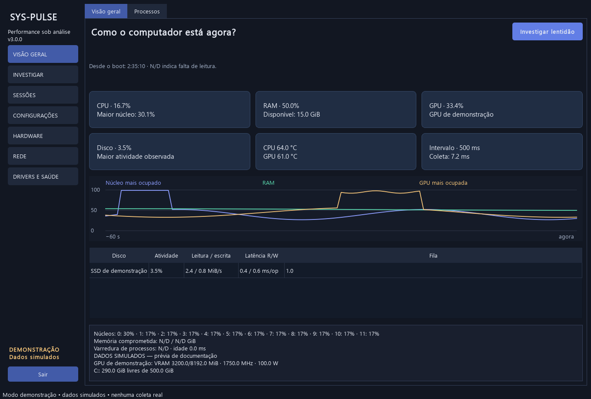
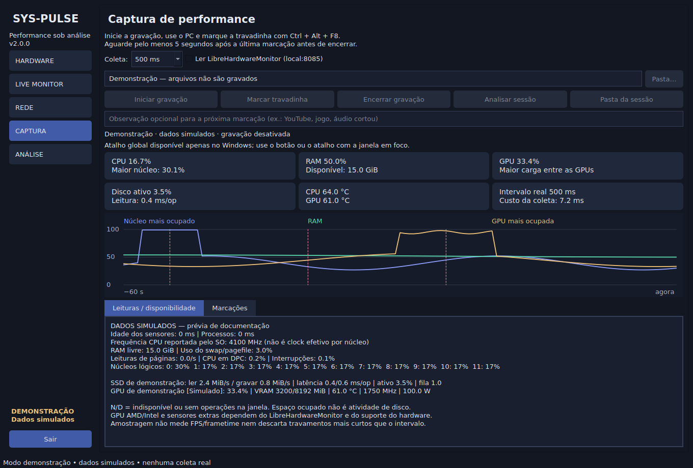
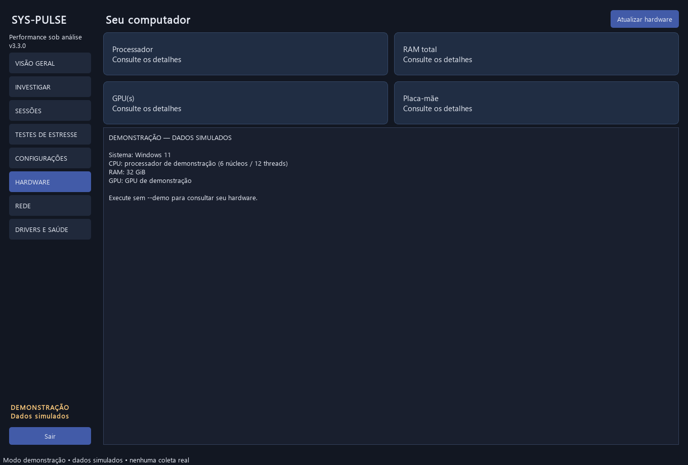
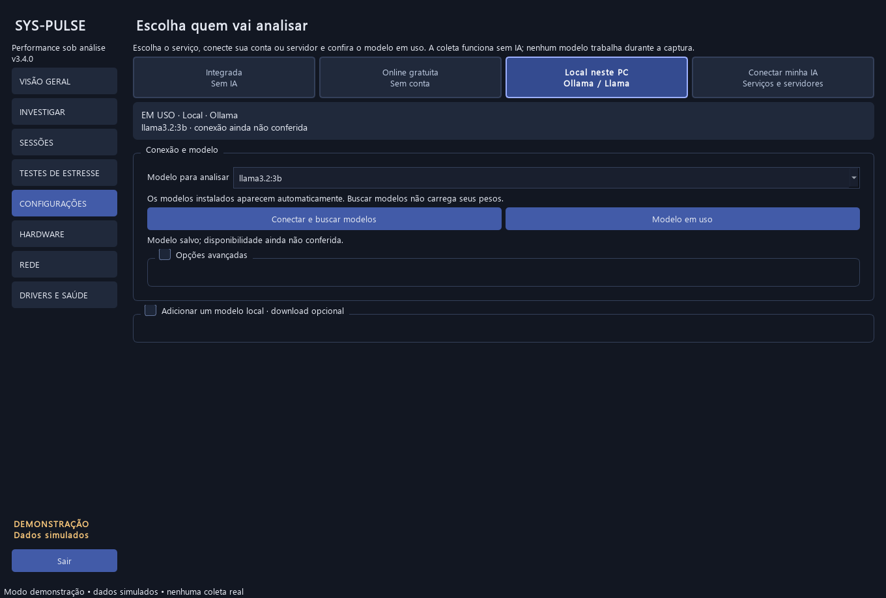

# SysPulse 3.0

**Grave o desempenho, marque o sintoma e investigue as evidências.**

Aplicativo desktop em Python e PySide6 para acompanhar CPU, memória, GPU, discos e rede. A análise local funciona sem conta, internet ou modelo de IA. A integração opcional com IA só trabalha depois da captura.



Os prints e a sessão de demonstração usam **dados simulados**, identificados na interface.

## Downloads

**[Baixar os instaladores no GitHub Releases](https://github.com/Kennedh/sys-pulse/releases/latest)** · [Todos os downloads](https://github.com/Kennedh/sys-pulse/releases) · [Guia de instalação](docs/downloads.md)

Os arquivos ficam em **Releases → Assets** no GitHub. Modelos de IA não acompanham o instalador.

| Sistema | Arquivo da versão 3.0 | Instalação |
|---|---|---|
| Windows x64 | [Setup.exe](https://github.com/Kennedh/sys-pulse/releases/download/v3.0.0/SysPulse-3.0.0-Windows-x64-Setup.exe) | Escolha a pasta, os atalhos e como preparar a análise. Inclui desinstalador. |
| Linux x64 | [Setup.run](https://github.com/Kennedh/sys-pulse/releases/download/v3.0.0/SysPulse-3.0.0-Linux-x64-Setup.run) | Escolha uma pasta exclusiva. Não precisa de root ao instalar na pasta do usuário. |
| macOS Apple Silicon | [Setup.pkg](https://github.com/Kennedh/sys-pulse/releases/download/v3.0.0/SysPulse-3.0.0-macOS-arm64-Setup.pkg) | Instalador nativo, com destino padrão em Aplicativos. |
| macOS Intel | [Setup.pkg](https://github.com/Kennedh/sys-pulse/releases/download/v3.0.0/SysPulse-3.0.0-macOS-x64-Setup.pkg) | Instalador nativo para Intel. |

A seção Assets também oferece ZIP portátil no Windows, TAR.GZ no Linux, DMG no macOS e SHA256SUMS.txt para conferir a integridade. No DMG, arraste o aplicativo para a pasta desejada. A disponibilidade de cada arquivo depende de seu build nativo concluir com sucesso.

Windows usa Python e Qt empacotados. No Linux, bibliotecas gráficas do sistema continuam necessárias; a base de build é Ubuntu 22.04. O pacote macOS declara mínimo de macOS 13; o Ollama atual tem requisitos próprios, incluindo macOS 14 ou superior. Consulte o [guia por sistema](docs/downloads.md).

Os pacotes ainda não possuem certificado comercial de assinatura nem notarização Apple. Confira a origem e o SHA-256. O sistema pode exibir aviso de editor não verificado.

## Instalar e começar

Não precisa instalar Python para usar os pacotes. Na primeira abertura, escolha **Análise integrada**, **IA local** ou **IA anônima na nuvem**. Essa escolha não inicia download ou inferência; as opções ficam disponíveis em Configurações.

No projeto, iniciar.bat abre dist/SysPulse/SysPulse.exe ou o ambiente Python local.

1. Aguarde a consulta inicial do inventário.
2. Abra **INVESTIGAR**, escolha a tarefa e mantenha **Leve · acompanhe a sessão inteira** para começar.
3. Escolha o aplicativo se quiser acompanhar um processo específico. Para quadros, selecione o processo que realmente apresenta a imagem.
4. Clique em **Iniciar** e use o computador. Ao perceber o sintoma, use **Marcar** ou **Ctrl + Alt + F8**.
5. Aguarde pelo menos cinco segundos após a última marcação e clique em **Encerrar**. A análise abre automaticamente.
6. Comece pela explicação. Confira recursos, processos, marcações e quadros nas tabelas de evidências.

Fechar a janela minimiza para a bandeja quando disponível. Use **Sair** para finalizar o aplicativo. Confira antes de jogar se o atalho global foi registrado e funciona no seu ambiente.



## Escolher a captura

| Modo | Uso | Dados e limites |
|---|---|---|
| Leve | Trabalhar, jogar ou acompanhar uma tarefa por mais tempo | Recursos contínuos, processo escolhido, marcações e relatório. Duração de 15, 30, 60 ou 120 minutos; padrão de 30 minutos. |
| Detalhada · próximo sintoma | Aguardar uma pausa difícil de reproduzir | Recursos contínuos e WPR circular em memória. A primeira marcação solicita o salvamento após mais cinco segundos. O ETL preserva eventos recentes; partes antigas podem ser sobrescritas. |
| Detalhada · reprodução curta | Reproduzir o problema em poucos minutos | WPR em arquivo, até três minutos e limite aproximado de 1 GiB temporário. |

O modo circular reserva aproximadamente **128 MiB para buffers do kernel**, além dos recursos do WPR. O ETL salvo tem tamanho variável. Não equivale a registrar todos os eventos detalhados de uma partida inteira.

As capturas WPR solicitam administrador pelo UAC apenas para o auxiliar. O software controla sua própria instância. Para processar ETL, instale o [Windows Performance Toolkit](https://learn.microsoft.com/en-us/windows-hardware/test/wpt/) com Xperf. A coleta nativa funciona sem ele.

**Mais opções** reúne intervalo, pasta, sensores extras, PresentMon e acesso ao ETL. A interface impede capturas simultâneas e análise por IA durante uma gravação.

## Quadros e frametimes

Ao investigar imagem engasgando, habilite a captura de quadros e selecione o aplicativo. O pacote gerado com a ferramenta local inclui o [PresentMon](https://github.com/GameTechDev/PresentMon); no código-fonte, informe o executável em Mais opções ou disponibilize-o no PATH.

O modo de coleta mínimo registra os intervalos produzidos pelo aplicativo, separados por PID e swapchain. A análise mostra mediana, P95, P99, máximo, intervalos longos e recursos observados perto dos maiores eventos. São usados QPC e relógio monotônico para essa associação.

Esse modo não registra latência de entrada, tempo efetivamente exibido ou ocupação da GPU por quadro. Inicialização, minimização e limitadores também podem produzir intervalos longos. Os dados mostram o evento; isoladamente, não confirmam sua causa.

Os frametimes são comprimidos ao encerrar. Um limite aproximado de 256 MiB no CSV interrompe essa coleta, mantendo os recursos nativos. Ausência de suporte, permissão ou quadros aparece como aviso.

## Hardware, visão geral e rede

- **Visão geral:** cartões de CPU, RAM, GPU, disco, temperaturas e custo da coleta; histórico e detalhes.
- **Hardware:** processador, placa-mãe, BIOS, módulos de RAM, discos, GPU, driver gráfico, frequência de atualização informada e plano de energia.
- **Rede:** interfaces, endereços, máscara, MTU, tráfego, destino de ping configurável, respostas, timeouts e variação entre respostas.
- **Drivers e saúde:** consulta pontual de dispositivos PnP, armazenamento e eventos selecionados do Windows.



A disponibilidade depende do hardware, driver e permissões. N/D significa ausência de informação. Ping ao destino escolhido não representa automaticamente a latência de um jogo. Sem resposta ICMP não comprova perda de pacotes do aplicativo.

Temperatura, clock efetivo, configuração de canais de memória, saúde SMART/NVMe completa e integridade física não estão garantidos por essas consultas. O software não altera clocks, tensões, drivers ou planos de energia.

Sensores extras podem ser lidos do [LibreHardwareMonitor](https://github.com/LibreHardwareMonitor/LibreHardwareMonitor) em http://127.0.0.1:8085/data.json. Ative seu servidor local e a opção correspondente em Mais opções. NVIDIA também usa NVML quando disponível.

## IA sem login ou chave

A explicação integrada funciona imediatamente, sem internet, conta ou modelo.

Para complementar pela internet, escolha **Nuvem · anônima, sem login ou chave** em Configurações. O SysPulse consulta o catálogo do **AI Horde**, um serviço comunitário com workers voluntários. O modo auto escolhe um modelo disponível considerando compatibilidade geral e fila; também é possível escolher um modelo da lista.

Não é necessário criar conta, colar chave, instalar Ollama ou baixar pesos para essa opção. O software usa o identificador público de acesso anônimo previsto pelo serviço.

Acesso anônimo tem prioridade baixa e pode ser restringido em períodos de carga alta. A espera na fila é limitada a 90 segundos, além dos timeouts de rede; **Cancelar espera** remove a solicitação pendente. Falha de rede, ausência de worker ou resposta inválida preserva a análise integrada. Não há garantia de disponibilidade nem de precisão do modelo.

**Privacidade:** os workers comunitários recebem o resumo e podem armazenar o que processam. A confirmação identifica o destino antes do envio. Use somente evidências que aceite compartilhar com esse serviço. O software exclui processos, caminhos, IPs, anotações, inventário e ETL do resumo.

## Baixar e usar um modelo local

Em **CONFIGURAÇÕES → Local · Ollama**:

1. Clique em **Baixar Ollama**, instale o programa oficial e volte ao SysPulse.
2. Clique em **Detectar / iniciar Ollama**. Um servidor já aberto é reutilizado; o SysPulse não encerra servidores de outros programas.
3. Escolha um modelo no catálogo ou digite um nome válido da biblioteca do Ollama.
4. Clique em **Baixar modelo escolhido** e confirme o download. A tela mostra progresso por camada e permite cancelar.
5. Ao concluir, o modelo fica selecionado para analisar sessões encerradas.

| Modelo do catálogo | Download aproximado | Observação |
|---|---:|---|
| Qwen 3 0.6B | 523 MB | Menor download; dois casos sintéticos passaram no teste desta máquina. |
| Llama 3.2 1B | 1,3 GB | Opção compacta; qualidade ainda não medida neste projeto. |
| Llama 3.2 3B | 2 GB | Testado nesta máquina; requer mais recursos durante a análise. |

Download em disco não equivale a RAM/VRAM necessária. Modelos maiores e contextos longos consomem mais recursos; não há tamanho universal adequado para todo computador. A licença e os detalhes de cada modelo estão na [biblioteca do Ollama](https://ollama.com/library).

O modelo fica no armazenamento do Ollama, separado da pasta onde o SysPulse foi instalado. O local padrão depende do sistema e do usuário que executa o servidor. Para mudar, configure OLLAMA_MODELS no Ollama e reinicie esse servidor; mudar a pasta do SysPulse não move modelos existentes. Veja [instalação e armazenamento](docs/downloads.md).

Downloads interrompidos podem aproveitar as camadas já baixadas ao tentar novamente. Durante download, preparação ou inferência, novas capturas ficam bloqueadas para evitar interferência. Selecionar um modelo ou listar o catálogo não inicia inferência.

Após cada análise nativa no Ollama, o SysPulse solicita o descarregamento com keep_alive=0. Outros programas podem manter modelos carregados por conta própria. Desinstalar o SysPulse não remove o Ollama, seus modelos ou as sessões gravadas.



## Outras opções de IA

LM Studio, conta Ollama na nuvem, Gemini, OpenRouter, OpenAI e endpoint compatível continuam disponíveis para quem já utiliza esses serviços. A opção anônima descrita acima não depende deles.

Ollama Cloud usa login da conta no próprio Ollama, sem copiar sua chave para o SysPulse. Gemini, OpenRouter, OpenAI e APIs compatíveis podem exigir chave e cobrança. Não há chave do autor embutida nem assinatura contratada pelo aplicativo. Gratuidade, cotas e preços pertencem a cada provedor.

Uma chave informada fica em memória. **Lembrar chave** é opcional e usa o Gerenciador de Credenciais do Windows; preferências comuns não armazenam a chave em texto. HTTP só é aceito em loopback; serviços externos exigem HTTPS.

## Como a IA participa da análise

A coleta e a análise por regras continuam independentes da IA. Depois da captura, o software prepara métricas, unidades e candidatos a investigação, com tamanho limitado. A prévia permite conferir o que será enviado.

A IA apenas prioriza IDs de evidências. O software valida o formato e os IDs e apresenta os valores originais; não aceita números ou causas inventados pelo modelo. Respostas inválidas são recusadas. Isso protege as referências, mas não comprova que a prioridade escolhida seja a melhor hipótese.

Sem candidatos, a resposta é local, sem consulta a um modelo. Respostas repetidas podem usar cache em memória. A tela informa tokens quando o provedor os disponibiliza; no AI Horde a contagem fica N/D. A modalidade anônima envia até oito candidatos, com contexto reduzido e saída limitada a 256 tokens.

## Testes dos modelos nesta máquina

Casos sintéticos de CPU e armazenamento, no Windows, com o mesmo contrato usado pela interface. Não são capturas de defeitos reais nem um ranking universal dos modelos.

| Modelo | Download em disco | CPU sintética | Disco sintético | Tokens entrada/saída |
|---|---:|---:|---:|---|
| Llama 3.2 3B | 2.019.393.189 bytes | 3,31 s | 3,38 s | 287/24 e 289/24 |
| Qwen 3 0.6B | 522.653.767 bytes | 14,62 s | 2,77 s | 286/25 e 289/25 |
| IA anônima / modelo disponível no teste | Sem pesos locais | 13,52 s com fila | Não medido | Não informado |

O Qwen foi baixado pelo novo fluxo em aproximadamente 12,75 s; o teste do Llama reutilizou camadas existentes. A primeira chamada e a carga da máquina influenciam os tempos; essas execuções não são um comparativo controlado.

Os dois modelos locais retornaram IDs compatíveis nos dois casos. Sem candidatos, ambos consumiram zero tokens e não foram chamados. A listagem do Ollama ficou sem modelos carregados ao final. No teste anterior do Llama 3B, foram observados aproximadamente 3,12 GB decimais de VRAM durante a análise, liberados após a chamada.

Na nuvem anônima, uma resposta anterior foi rejeitada por formato inválido; a chamada seguinte produziu uma referência válida ao caso sintético de CPU. Disponibilidade e modelo escolhido podem mudar entre chamadas.

Os resultados completos, com entradas sintéticas e respostas, estão em [examples/validacao-modelos](examples/validacao-modelos). Para repetir:

```powershell
.venv\Scripts\python.exe tools/validate_local_model.py --model llama3.2:3b
.venv\Scripts\python.exe tools/validate_local_model.py --model qwen3:0.6b --download
```

## Arquivos e consumo

A sessão usa compressão gzip rápida por padrão. O CSV de métricas é exportado sob demanda, evitando duplicar dados durante a gravação. Capturas antigas sem compressão continuam compatíveis.

| Arquivo | Conteúdo |
|---|---|
| amostras.jsonl.gz | Recursos, dispositivos e processos selecionados. |
| frametimes.csv.gz | Quadros do processo escolhido, quando habilitados e disponíveis. |
| marcacoes.csv e eventos.jsonl | Marcações e janelas de recursos. |
| sessao.json | Versão, duração, limites, encerramento, perdas e avisos. |
| inventario.json | Consulta pontual do Windows, quando disponível. |
| relatorio.txt, analise.txt e analise.json | Relatórios e resultado estruturado. |
| captura.etl e relatórios avançados | Eventos detalhados e saídas do Xperf nos modos WPR. |

São preservados os dez maiores processos por CPU, RAM, I/O e GPU, sem duplicatas, além do processo escolhido. A varredura por processo ocorre aproximadamente a cada dois segundos; o intervalo padrão dos recursos é 500 ms.

A gravação nativa limita o JSONL a **256 MiB antes da compressão ou duas horas**, além da duração escolhida. Outros arquivos acrescentam espaço. Pouco espaço livre encerra a gravação com aviso. Filas cheias e lacunas são informadas.

Uma sessão real de 30 minutos nesta máquina produziu **3,06 MiB de amostras comprimidas e 3,82 MiB no total com relatórios**, sem quadros ou ETL nessa sessão. Tamanhos e consumo variam com a tarefa e os modos ativos. Consulte [medições e limites da validação](docs/validacao-2.3.md).

Pastas, JSONL simples/comprimido e ZIP com uma única sessão podem ser reabertos. A leitura tem limites de volume e linhas. ZIPs são lidos sem extrair arquivos. Os gráficos podem agrupar pontos, preservando picos; os cálculos usam as amostras válidas.

Capturas originais podem conter nomes de processos, dispositivos, horários, IPs e mensagens do Windows. O ETL também pode conter caminhos. Revise os arquivos antes de compartilhar. O resumo enviado à IA é separado dessas capturas.

## Entender os resultados

A explicação compara recursos perto das marcações com o restante da sessão e informa cobertura, lacunas e dados indisponíveis. Janelas sobrepostas são deduplicadas na comparação agregada.

CPU por processo é normalizada pelo total de CPUs lógicas. I/O por processo pode envolver dispositivos e rede; não identifica sozinho um disco físico. GPU por processo usa o engine mais ocupado e não deve ser somada entre engines. Primeiras leituras e contadores reiniciados ficam N/D.

O P95 usa a posição ceil(0,95 × quantidade). Tempo alto observado soma apenas intervalos entre leituras consecutivas acima do critério, com continuidade válida. Um pico isolado não representa duração contínua de saturação.

Critérios como CPU ≥90%, maior núcleo/GPU ≥95%, RAM/VRAM/disco ≥90% e latência média de disco ≥30 ms/op são heurísticas de triagem. Carga alta pode ser esperada e carga baixa não elimina uma pausa curta.

A análise ETL acrescenta DPC/ISR, execução por processo/thread, bytes e operações de arquivos e hard faults quando reconhecidos. Hard fault não significa defeito na RAM. Tempo de execução de uma thread não explica sozinho por que ela esperou. Não há reconstrução automática completa de pilhas, bloqueios ou causas.

## O que funciona em cada sistema

| Recurso | Windows | Linux e macOS |
|---|---|---|
| CPU, RAM, processos, tráfego, captura leve e relatórios | Sim, conforme permissões | Sim, conforme métricas expostas pelo sistema |
| IA integrada, modelos via Ollama e IA anônima | Sim | Sim |
| Temperaturas e GPU | Dependem de NVML/LHM, drivers e permissões | Dependem das fontes disponíveis; GPU Apple não é medida por NVML |
| WPR, ETL/Xperf, PresentMon integrado e inventário PnP/Event Log | Sim, com ferramentas e permissões | Indisponíveis nessas integrações |
| Atalho de marcação | Global quando registrado | Com a janela em foco |

O pacote multiplataforma não transforma contadores exclusivos do Windows em métricas de outros sistemas. Dado ausente fica N/D.

## Instalar pelo código-fonte

Use Python 3.10 ou superior, 64 bits. A validação desta versão usou Windows e Python 3.13.1.

```powershell
python -m venv .venv
.venv\Scripts\python.exe -m pip install -r requirements.txt
.venv\Scripts\python.exe main.py
```

Para conhecer a interface sem coleta real:

```powershell
.venv\Scripts\python.exe main.py --demo
```

Fontes exclusivas de Windows ficam indisponíveis em outros sistemas. Os instaladores são gerados no próprio sistema de destino.

## Desenvolvimento e validação

```powershell
.venv\Scripts\python.exe -m pip install -r requirements-dev.txt
.venv\Scripts\python.exe -m pytest -q
.venv\Scripts\python.exe tools/fetch_build_tools.py
.venv\Scripts\python.exe tools/build_release.py
.venv\Scripts\python.exe tools/validate_release.py
```

No Windows, fetch_build_tools.py baixa Inno Setup e PresentMon oficiais, com SHA-256 fixado e assinatura conferida. O build inclui o PresentMon e sua licença. Modelos de IA são instalados separadamente. Build, capturas reais, ferramentas baixadas, caches e configurações locais ficam fora do Git.

- tools/benchmark.py mede uma sessão real; --duration 1800 --offscreen permite repetir o acompanhamento de 30 minutos.
- tools/validate_graphics.py cria uma janela gráfica de teste para verificar quadros.
- tools/capture_screenshots.py recria os prints com dados simulados.
- modules/windows_processes.py agrupa a leitura de processos do Windows, com fallback.
- modules/ai_service.py e ai_contract.py separam transporte, resumo e validação das evidências.
- modules/frametimes.py e etl_details.py mantêm a interpretação dos formatos fora da interface.

A suíte Windows passou com 144 testes; Linux e macOS passaram com 143 e um teste exclusivo de Windows não aplicável. Os quatro pacotes nativos passaram nas verificações de instalação/abertura descritas na [validação 3.0](docs/validacao-3.0.md). O workflow [Instaladores e release](.github/workflows/release.yml) testa e gera os pacotes nos runners nativos; uma tag v3.x publica os arquivos em Releases somente após todos os builds passarem.

Veja [validação 3.0](docs/validacao-3.0.md), [validação anterior de coleta](docs/validacao-2.3.md), [histórico](CHANGELOG.md) e [revisão que orientou as melhorias](docs/revisao-produto-desempenho.md). As análises técnicas anteriores estão preservadas como histórico.

## Referências

- [AI Horde: acesso anônimo e limites](https://github.com/Haidra-Org/AI-Horde#anonymous-usage)
- [AI Horde: privacidade de prompts nos workers](https://github.com/Haidra-Org/AI-Horde/blob/main/FAQ.md)

- [PresentMon: métricas e execução](https://github.com/GameTechDev/PresentMon/blob/main/README-ConsoleApplication.md)
- [Microsoft: modos de gravação WPR](https://learn.microsoft.com/en-us/windows-hardware/test/wpt/logging-mode)
- [Microsoft: comandos WPR](https://learn.microsoft.com/en-us/windows-hardware/test/wpt/wpr-command-line-options)
- [Ollama: API Chat](https://docs.ollama.com/api/chat)
- [Gemini: compatibilidade OpenAI](https://ai.google.dev/gemini-api/docs/openai)
- [psutil](https://psutil.readthedocs.io/stable/)
- [NVIDIA NVML](https://docs.nvidia.com/deploy/nvml-api/latest/)
- [LibreHardwareMonitor](https://github.com/LibreHardwareMonitor/LibreHardwareMonitor)
