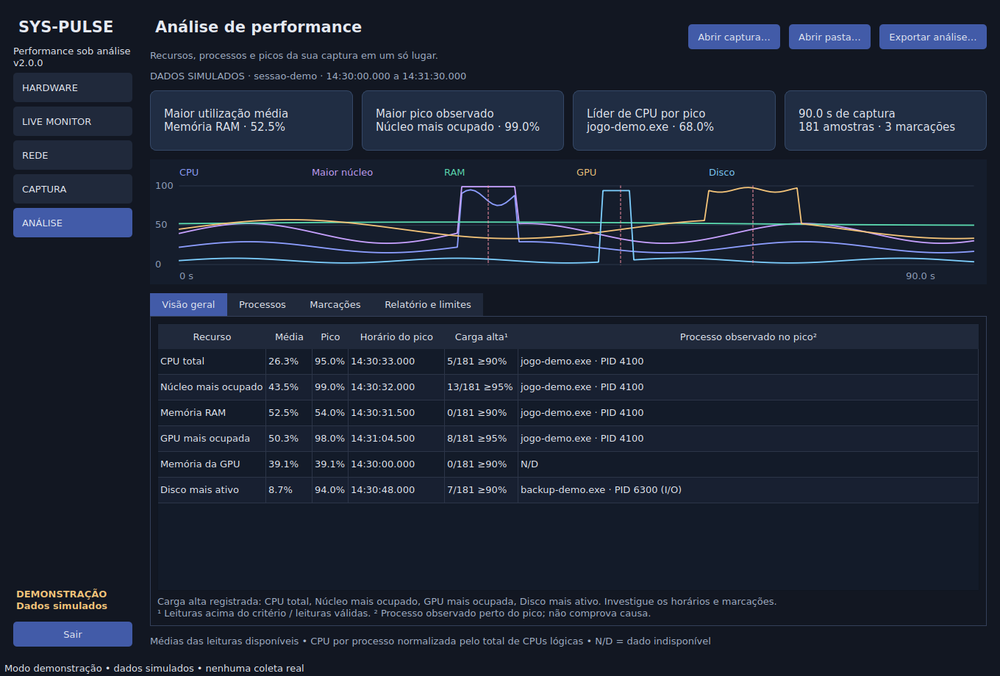
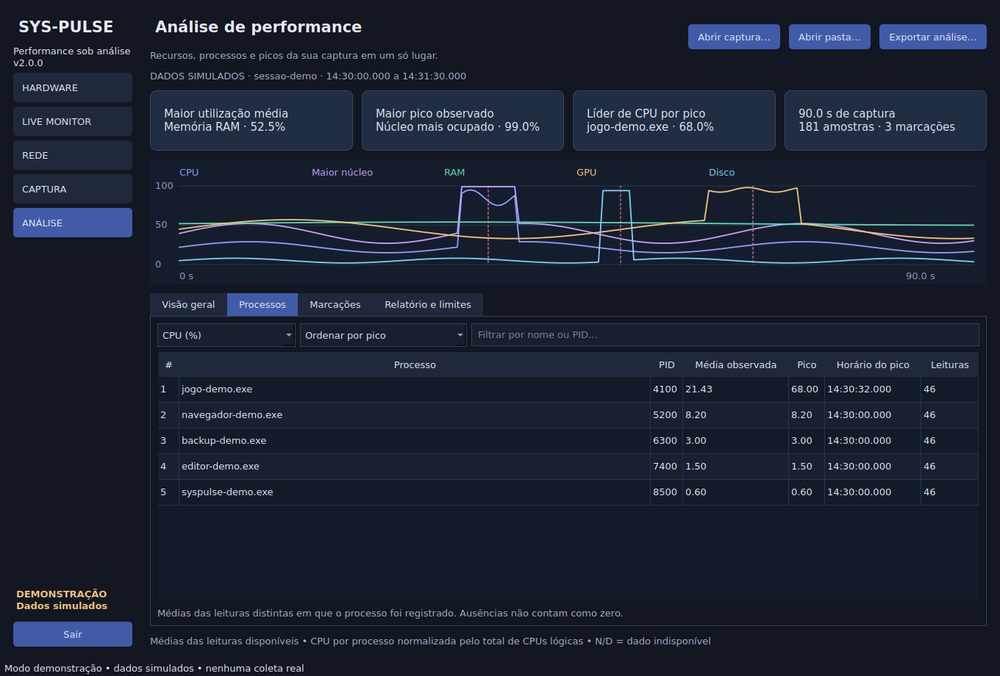
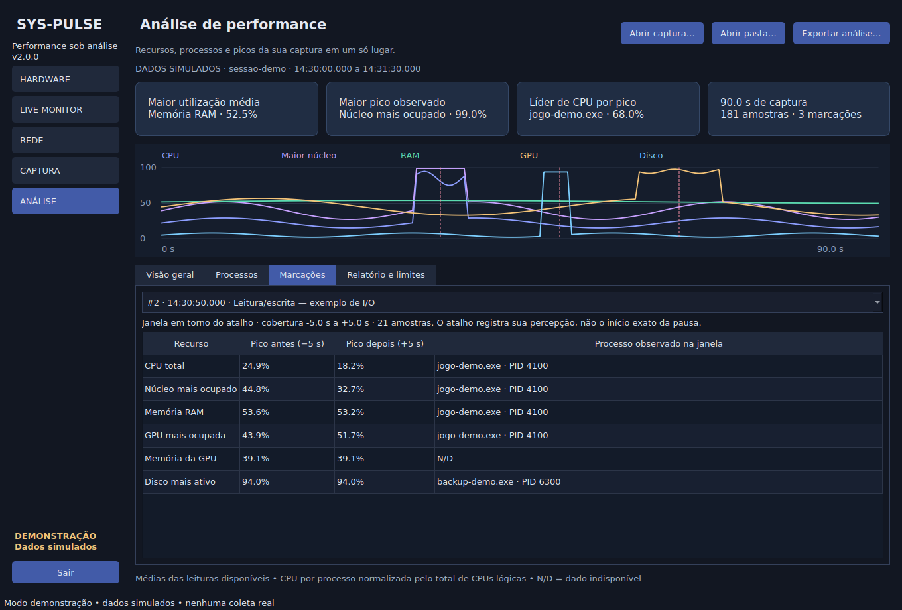

# SysPulse 2.0

**Grave o desempenho do computador e descubra quais recursos e processos mais consumiram durante a sessão.**

Aplicativo desktop em Python e PySide6 para acompanhar CPU, memória, GPU, discos e rede. Ao encerrar uma captura, o SysPulse abre a análise no próprio programa: médias, picos com horário, rankings de processos e comparação antes/depois das marcações.



> Os prints são capturas da interface real com **dados simulados**, identificados na tela. Não representam medições de um computador real.

## Recursos da versão 2.0

- **Análise automática** ao encerrar a gravação.
- **Resumo dos recursos:** média, pico, horário e quantidade de leituras com carga alta.
- **Rankings de processos:** CPU, RAM, leitura/escrita e GPU, conforme disponibilidade; filtro por nome/PID e ordenação por pico ou média observada.
- **Contexto dos picos:** processo com maior leitura do recurso no snapshot próximo do pico, sem presumir que ele causou uma travada.
- **Marcações:** `Ctrl + Alt + F8` registra uma percepção de travada; comparação de até 5 segundos antes e depois.
- **Sessões anteriores:** abre uma pasta, `amostras.jsonl`, `sessao.json` ou ZIP com uma única sessão. Compatível com as capturas da versão anterior.
- **Relatórios TXT e JSON:** salvos junto à nova captura e exportáveis pela interface.
- **Modo de demonstração:** interface com dados simulados, sem coleta real.

## Instalação

Use **Python 3.10 ou superior, 64 bits**. Extraia o projeto e abra o terminal na pasta que contém `main.py`.

```powershell
python -m venv .venv
.venv\Scripts\python.exe -m pip install -r requirements.txt
.venv\Scripts\python.exe main.py
```

No Linux, substitua `.venv\Scripts\python.exe` por `.venv/bin/python`. Sensores e contadores disponíveis variam conforme o sistema.

Se já utiliza o projeto, copie os arquivos desta versão para sua base e atualize as dependências. Suas sessões gravadas podem ser abertas na aba **ANÁLISE**. O SysPulse não exige LatencyMon nem Windows Performance Analyzer para suas capturas nativas.

Para conhecer a interface com a sessão simulada incluída:

```powershell
.venv\Scripts\python.exe main.py --demo
```

## Capturar e analisar

1. Abra **CAPTURA** e mantenha inicialmente o intervalo de **500 ms**.
2. Escolha a pasta de destino e clique em **Iniciar gravação**.
3. Use o computador normalmente. Durante um sintoma, pressione **Ctrl + Alt + F8** ou clique em **Marcar travadinha**. A observação é opcional.
4. Aguarde pelo menos **5 segundos** após a última marcação e clique em **Encerrar gravação**.
5. A aba **ANÁLISE** abre automaticamente. Consulte a visão geral, os processos e as marcações.
6. Use **Exportar análise…** para salvar outra cópia do relatório, ou **Pasta da sessão** para localizar os arquivos originais.


Não é necessário marcar uma travada para obter o resumo da sessão. O atalho registra quando o aplicativo recebeu a marcação, não o início exato do congelamento.

No Windows, o atalho é global quando consegue ser registrado. Em outros sistemas, funciona com a janela em foco. Jogos ou outros programas podem interceptá-lo; a tela informa falhas no registro global. Faça uma marcação de teste antes de jogar.

Fechar a janela minimiza para a bandeja, quando disponível. Use **Sair** para encerrar a coleta e finalizar a gravação. A análise pode ser aberta posteriormente caso você saia do aplicativo durante uma captura.

## Identificar os processos

Selecione CPU, RAM, leitura/escrita ou GPU na aba **Processos**. As linhas mantêm o **PID**: dois processos com o mesmo nome são exibidos separadamente. Novas capturas também distinguem a reutilização de um PID pelo horário de criação do processo.



| Informação | Como interpretar |
|---|---|
| Maior utilização média | Maior média percentual dos recursos disponíveis, excluindo o maior núcleo. Comparação descritiva: RAM ocupada e CPU trabalhando não têm o mesmo significado. |
| Maior pico observado | Maior percentual encontrado; inclui o núcleo mais ocupado. |
| Líder de CPU por pico | Processo individual com o maior pico de CPU registrado. |
| Média observada por processo | Média das leituras distintas em que o processo foi incluído. Ausências não são preenchidas com zero. |
| Processo observado no pico | Maior consumidor acessível daquele recurso no snapshot associado ao pico, normalmente atualizado a cada 2 s. Passe o mouse na célula para ver idade e dispositivo. |
| Carga alta | Leituras que atingiram o critério / leituras válidas. Não é duração contínua de saturação. |
| N/D | Dado indisponível no sistema ou ausente nessa captura. Não significa consumo zero. |

CPU por processo é normalizada pelo total de CPUs lógicas. O processo com maior CPU total não é necessariamente aquele que ocupou um núcleo específico. RAM do sistema também inclui kernel e caches; o maior RSS não explica sozinho toda a memória ocupada.

## Comparar as marcações

Escolha uma marcação para ver os picos antes/depois. A cobertura efetiva aparece na tela, inclusive em janelas parciais. Marcações próximas podem ter janelas sobrepostas: um pico repetido nelas não comprova dois eventos distintos.



## Métricas e disponibilidade

| Métrica | Fonte e observação |
|---|---|
| CPU total e por núcleo | `psutil`, a cada 250, 500 ou 1.000 ms. |
| CPU e RAM por processo | `psutil`, aproximadamente a cada 2 s; processos sem permissão podem ficar ausentes. |
| Leitura/escrita por processo | Diferença de `Process.io_counters()` / intervalo real, em MiB/s. Primeira leitura, falha ou reinício de contador = N/D. |
| GPU por processo | Windows PDH: engine mais ocupado por PID, a cada ~2 s. Depende de contadores e driver compatíveis. |
| GPU NVIDIA global | NVML: uso, VRAM, temperatura, clock e potência conforme suporte. |
| GPU AMD/Intel e temperatura CPU no Windows | Sensores opcionais via LibreHardwareMonitor. |
| Atividade e fila de disco no Windows | PDH por dispositivo; atividade = 100 − tempo ocioso. |
| Taxa de leitura/escrita por disco | Diferença dos bytes por intervalo real, em MiB/s. |
| Latência média de disco | Tempo acumulado / operações concluídas; sem operações = N/D. Alguns sistemas não fornecem tempos úteis. |
| Leituras de páginas/s | Windows `Memory / Page Reads/sec`; não se limita ao arquivo de paginação. |
| DPC e interrupções | Percentual do tempo de CPU; não mede latência DPC/ISR nem identifica drivers. |
| Frequência CPU | Reportada pelo SO; não é clock efetivo de cada núcleo. |
| Rede | Tráfego agregado, interfaces e ping a `8.8.8.8` a cada ~5 s. Sem ranking de rede por processo. |

**I/O por processo não identifica um disco físico.** No Windows pode incluir operações de dispositivos/rede; caches e buffers também fazem os números diferirem dos discos. O ranking fornece contexto, não prova que o processo saturou determinado disco.

GPU por processo usa o engine mais ocupado. Engines podem trabalhar simultaneamente; seus percentuais não devem ser somados nem comparados diretamente ao uso global via NVML. Não há atribuição de VRAM por processo. Capturas antigas não possuem I/O ou GPU por processo: esses rankings ficam como N/D.

### Sensores extras com LibreHardwareMonitor

1. Obtenha o programa no [repositório oficial](https://github.com/LibreHardwareMonitor/LibreHardwareMonitor/releases).
2. Confirme que os sensores aparecem nele. Algumas leituras exigem executar esse programa como administrador.
3. Ative **Options → Remote Web Server → Run**, na porta **8085**, usando a interface local/loopback quando disponível.
4. Em **CAPTURA**, marque **Ler LibreHardwareMonitor (local:8085)**.

O SysPulse consulta `http://127.0.0.1:8085/data.json`. Não altera clocks, tensões ou ventiladores. Sensores sem atualização por mais de 4 segundos ficam indisponíveis. NVIDIA via NVML e a coleta básica funcionam independentemente desse serviço.

## Arquivos da sessão

Destino padrão: `Documentos/SysPulse/diagnosticos`. Cada gravação cria uma subpasta.

| Arquivo | Conteúdo |
|---|---|
| `analise.txt` | Recursos, rankings, marcações e limitações da análise integrada. |
| `analise.json` | Resultado estruturado da análise integrada. |
| `amostras.jsonl` | Leituras completas, dispositivos e processos selecionados. |
| `metricas.csv` | Métricas principais; UTF-8 com BOM, vírgula e ponto decimal. |
| `marcacoes.csv` | Horário com fuso, monotônico, número e observação. |
| `eventos.jsonl` | Resumo de cada janela de marcação. |
| `relatorio.txt` | Relatório básico do gravador, mesmo sem abrir a análise. |
| `sessao.json` | Formato, versão, início/fim, limites e perdas informadas. |

As capturas guardam a união dos **10 maiores processos por CPU, RAM, I/O e GPU**, sem duplicatas. A tabela ao vivo pode mostrar mais processos. Leituras em cache não contam novamente no ranking. Não se somam processos de mesmo nome nem se estima o consumo dos ausentes.

A gravação usa uma thread separada, fila limitada e flush a cada ~2 s. Para automaticamente em **256 MiB de JSONL ou 2 horas**; outros arquivos acrescentam espaço. Fila cheia e atrasos são informados. Interrupção abrupta pode deixar o final incompleto; a análise aproveita linhas válidas e avisa sobre linhas inválidas ou fora de ordem.

ZIPs são lidos sem extração. A importação exige uma única sessão e limita o JSONL a 512 MiB, 120.000 linhas e 1 MiB por linha. Sessões longas agrupam pontos do gráfico preservando o pico de cada intervalo visual; cálculos usam todas as amostras válidas.

Capturas podem conter nomes de processos, dispositivos, horários e IPs locais. Não coletam conteúdo de arquivos ou linhas de comando. Os prints e a sessão de exemplo distribuídos contêm somente dados simulados.

## Limites da análise

Critérios de triagem: CPU total ≥90%, maior núcleo/GPU ≥95%, RAM/VRAM/atividade de disco ≥90%. O relatório básico também observa latência média de disco ≥30 ms/op e CPU em DPC ≥5%. **Não são limites universais de defeito.**

Uso alto pode ser esperado; uso baixo não elimina microtravamentos. O SysPulse **não mede FPS/frametime nem comprova integridade física de CPU, GPU, RAM, placa-mãe ou fonte**. Não recomenda comprar peças com base em um pico.

**Arquivos `.etl` do WPR não são importados nesta versão.** Exigem decodificação e análise específica, como a do Windows Performance Analyzer. A análise integrada utiliza capturas nativas do SysPulse.

## Desenvolvimento

| Arquivo / pasta | Função |
|---|---|
| `main.py`, `gui.py` | Entrada, navegação e ciclo de vida. |
| `modules/analysis.py`, `analysis_view.py` | Análise independente da interface e apresentação dos resultados. |
| `modules/diagnostics.py`, `diagnostic_view.py` | Gravador, janelas de eventos e tela de captura. |
| `modules/monitor.py`, `windows_counters.py` | Coleta e contadores PDH. |
| `modules/sensors.py`, `network.py`, `hardware.py` | Sensores, rede, inventário e BIOS. |
| `modules/hotkey.py` | Atalho global. |
| `modules/demo.py`, `examples/sessao-demo/` | Demonstração com dados simulados. |
| `docs/images/`, `tools/capture_screenshots.py` | Prints e geração reproduzível. |
| `tests/` | Testes do gravador, métricas e análise. |

```powershell
.venv\Scripts\python.exe -m pip install pytest
.venv\Scripts\python.exe -m pytest -q
```

Para gerar novamente os prints da interface com dados simulados:

```powershell
.venv\Scripts\python.exe tools/capture_screenshots.py
```

Validação desta entrega: testes automatizados de cálculos, dados ausentes, cache, reutilização de PID, ZIP, sessões parciais, marcações e gravação; importação das duas capturas reais da versão anterior; fluxo completo de coleta → marcação → parada → análise → relatórios em Linux. A interface foi renderizada e os prints revisados. A coleta de GPU por processo via PDH ainda precisa de validação no Windows de destino; indisponibilidade é tratada como N/D.

## Referências

- [psutil](https://psutil.readthedocs.io/stable/)
- [NVIDIA NVML](https://docs.nvidia.com/deploy/nvml-api/latest/)
- [Microsoft: GPU e engines por processo](https://devblogs.microsoft.com/directx/gpus-in-the-task-manager/)
- [Microsoft PDH](https://learn.microsoft.com/en-us/windows/win32/api/pdh/nf-pdh-pdhgetformattedcounterarrayw)
- [LibreHardwareMonitor](https://github.com/LibreHardwareMonitor/LibreHardwareMonitor)

MIT License · Desenvolvido por [Kennedh](https://github.com/Kennedh).
