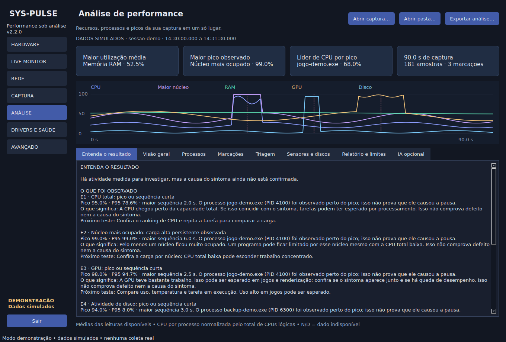
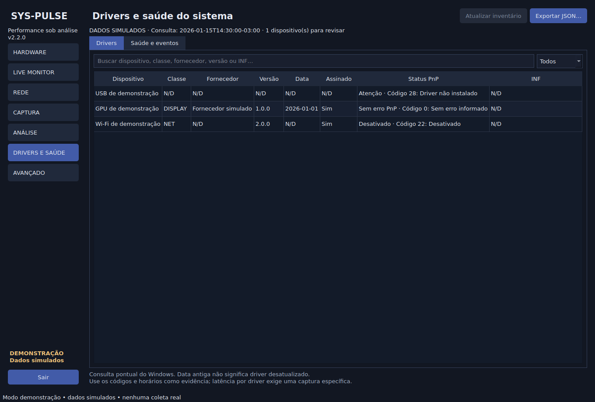
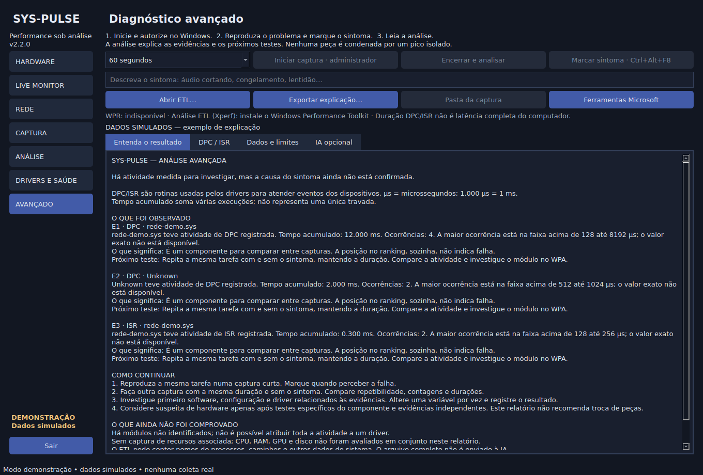
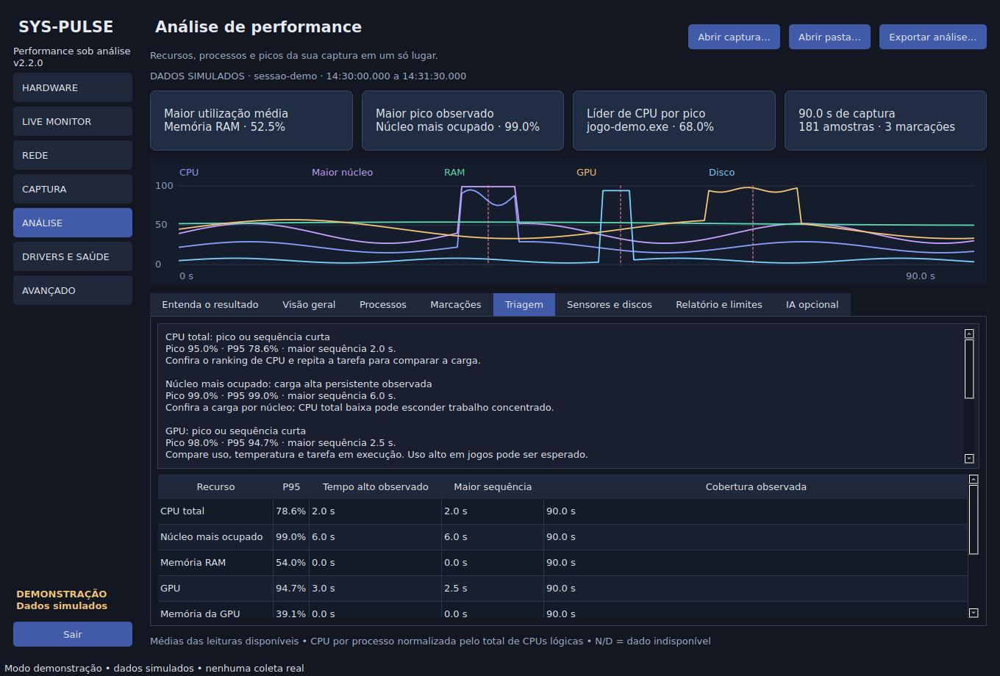

# SysPulse 2.2

**Grave o desempenho do computador e descubra quais recursos e processos mais consumiram durante a sessão.**

Aplicativo desktop em Python e PySide6 para acompanhar CPU, memória, GPU, discos e rede. Ao encerrar uma captura, o SysPulse explica o que foi observado, o que os dados permitem concluir e qual teste fazer em seguida. Os gráficos, rankings e dados técnicos continuam disponíveis para conferir as evidências.


> Os prints são capturas da interface real com **dados simulados**, identificados na tela. Não representam medições de um computador real.

## Novidades da versão 2.2

- **Entenda o resultado:** explicação local, em português, para capturas normais e avançadas. Funciona sem internet, conta ou modelo de IA.
- **Captura avançada:** solicita administrador pelo UAC apenas para o processo auxiliar de captura WPR; duração selecionável e marcação do sintoma.
- **Análise de ETL:** utiliza o Xperf do Windows Performance Toolkit para resumir DPC/ISR por módulo, com contagem, duração acumulada, média e maior faixa reconhecida do histograma.
- **Contexto de recursos:** uma gravação nativa acompanha a captura avançada e entra na explicação, sem presumir alinhamento exato ou causalidade.
- **IA opcional:** integração preparada para Ollama local ou serviço compatível com Chat Completions. O envio exige ação explícita e mostra previamente o resumo; o ETL completo não é enviado.
- **Encerramento:** finaliza recursos antes da análise, tenta salvar ao sair e limita comandos WPR à instância criada pelo SysPulse.



Veja [como usar e validar a análise avançada](docs/analise-avancada.md). A captura WPR, a elevação UAC e o processamento real do ETL **ainda precisam de validação no Windows**; aqui foram testados com respostas simuladas.

## Revisão da investigação de travamentos

- A explicação prioriza a carga perto das marcações e compara sua frequência com o restante da sessão.
- Janelas sobrepostas contam uma vez na comparação agregada; cobertura parcial e lacunas ficam explícitas.
- A varredura de processos roda em uma thread própria, com intervalo mínimo de 2 s, para não bloquear as métricas rápidas. A idade e o custo dessa leitura são preservados.
- A triagem também destaca latência média de disco a partir de 30 ms/op, com atividade, fila e IOPS da mesma amostra e do mesmo dispositivo.
- As estatísticas do ETL reconhecem perdas totais e por rastreamento sem somá-las duas vezes.
- A comparação é descritiva: carga fora das marcações também pode ter ocorrido com sintoma. Não confirma causalidade.

Veja os achados, as alterações e o que foi realmente validado em [Revisão de travamentos](docs/revisao-travamentos.md).

## Recursos mantidos da versão 2.1

- **Drivers e saúde:** inventário de dispositivos PnP, versão, fornecedor, data, assinatura informada pelo WMI e código de status do Windows. Busca e filtros na própria tela.
- **Armazenamento:** saúde informada pelo Windows, temperatura, desgaste, horas ligadas e erros não corrigidos quando o dispositivo expõe os contadores.
- **Eventos do Windows:** até 100 eventos críticos, de erro ou aviso de provedores selecionados nas últimas 24 horas.
- **Triagem:** P95, tempo alto observado, maior sequência de carga alta e próximos passos por recurso.
- **Sensores e discos:** mínimo, média, máximo e número de leituras por dispositivo; temperatura, clock, potência, tensão e ventilação dependem das fontes disponíveis.
- **IOPS e fila:** operações por segundo e fila por disco no monitor e no relatório.
- **Captura com contexto:** `inventario.json` acompanha a sessão quando a consulta termina durante a gravação ou existe uma consulta anterior.
- **Precisão:** primeira leitura de CPU de um processo novo fica N/D; sensores em cache contam uma vez nas novas estatísticas.

A [comparação técnica](docs/analise-tecnica.md) explica as referências usadas, as mudanças e o que ainda depende de validação no Windows.

## Recursos de captura e análise

- **Análise automática** ao encerrar a gravação.
- **Resumo dos recursos:** média, pico, horário e quantidade de leituras com carga alta.
- **Rankings de processos:** CPU, RAM, leitura/escrita e GPU, conforme disponibilidade; filtro por nome/PID e ordenação por pico ou média observada.
- **Contexto dos picos:** processo com maior leitura do recurso no snapshot próximo do pico, sem presumir que ele causou uma travada.
- **Marcações:** `Ctrl + Alt + F8` registra uma percepção de travada; comparação de até 5 segundos antes e depois.
- **Sessões anteriores:** abre uma pasta, `amostras.jsonl`, `sessao.json` ou ZIP com uma única sessão. Compatível com as capturas da versão anterior.
- **Relatórios TXT e JSON:** salvos junto à nova captura e exportáveis pela interface.
- **Modo de demonstração:** interface com dados simulados, sem coleta real.

## Instalação

Use **Python 3.10 ou superior, 64 bits**. Extraia o projeto e abra o terminal na pasta que contém `main.py`.

```powershell
python -m venv .venv
.venv\Scripts\python.exe -m pip install -r requirements.txt
.venv\Scripts\python.exe main.py
```

No Linux, substitua `.venv\Scripts\python.exe` por `.venv/bin/python`. Sensores e contadores disponíveis variam conforme o sistema.

Se já utiliza o projeto, copie os arquivos desta versão para sua base e atualize as dependências. Suas sessões gravadas podem ser abertas na aba **ANÁLISE**. O SysPulse não exige LatencyMon nem Windows Performance Analyzer para suas capturas nativas.

Para conhecer a interface com a sessão simulada incluída:

```powershell
.venv\Scripts\python.exe main.py --demo
```

## Drivers e saúde

Abra **DRIVERS E SAÚDE**. A consulta roda em segundo plano ao abrir o aplicativo, iniciar uma gravação ou clicar em **Atualizar inventário**. Ela pode levar até 45 segundos e usa PowerShell/CIM nativos, sem instalar módulos ou alterar dispositivos. O inventário tem um horário próprio: não é monitoramento contínuo.

- **Atenção:** código de problema PnP ou WMI informando ausência de assinatura. Confira os detalhes no Gerenciador de Dispositivos.
- **Desativado / Ausente:** estados separados, pois podem ser intencionais.
- **Sem erro PnP:** o Windows informou código zero; não comprova integridade ou ausência de stutter.
- **N/D / erro de consulta:** falta de dado, permissão ou suporte. Nenhum desses estados equivale a saudável.

Data antiga não comprova driver desatualizado. O SysPulse não consulta um catálogo de versões e não atualiza drivers automaticamente. Assinatura é a informação do WMI; não há nova verificação criptográfica dos arquivos.

Na aba **Saúde e eventos**, consulte discos e ocorrências de WHEA, Kernel-Power, disk, Ntfs, stornvme, storahci, Display e WER-SystemErrorReporting. Só são consultados os níveis crítico, erro e aviso do log System. Não encontrar registros nesse recorte não comprova ausência de problemas. Kernel-Power 41, isoladamente, não identifica a causa de um desligamento.

`Get-PhysicalDisk` e `Get-StorageReliabilityCounter` dependem de dispositivo, controlador e permissão. USB/RAID podem ocultar informações. A saúde informada pelo Windows não é uma leitura completa de atributos SMART/NVMe nem um teste físico. Em Linux, essa consulta fica explicitamente indisponível; a coleta de recursos continua.

Use **Exportar JSON…** para salvar o inventário. Nas capturas, uma consulta concluída atualiza `inventario.json` enquanto a gravação estiver ativa. Se encerrar antes de ela terminar, pode permanecer o inventário anterior ou não haver inventário; confira o horário no relatório. Consultas de inventário também consomem recursos: para uma medição mais estável, aguarde a conclusão antes de reproduzir o sintoma.



## Capturar e analisar

1. Abra **CAPTURA** e mantenha inicialmente o intervalo de **500 ms**.
2. Escolha a pasta de destino e clique em **Iniciar gravação**.
3. Use o computador normalmente. Durante um sintoma, pressione **Ctrl + Alt + F8** ou clique em **Marcar travadinha**. A observação é opcional.
4. Aguarde pelo menos **5 segundos** após a última marcação e clique em **Encerrar gravação**.
5. A aba **ANÁLISE** abre automaticamente. Comece por **Entenda o resultado**; consulte a visão geral, os processos e as marcações para conferir os detalhes.
6. Use **Exportar análise…** para salvar outra cópia do relatório, ou **Pasta da sessão** para localizar os arquivos originais.


Não é necessário marcar uma travada para obter o resumo da sessão. O atalho registra quando o aplicativo recebeu a marcação, não o início exato do congelamento.

No Windows, o atalho é global quando consegue ser registrado. Em outros sistemas, funciona com a janela em foco. Jogos ou outros programas podem interceptá-lo; a tela informa falhas no registro global. Faça uma marcação de teste antes de jogar.

Fechar a janela minimiza para a bandeja, quando disponível. Use **Sair** para encerrar a coleta e finalizar a gravação. A análise pode ser aberta posteriormente caso você saia do aplicativo durante uma captura.

## Captura avançada, ETL e IA

1. No Windows, instale o **Windows Performance Toolkit** pelo instalador oficial do Windows ADK para disponibilizar o Xperf. O botão **Ferramentas Microsoft** abre a documentação oficial.
2. Abra **AVANÇADO**, escolha a duração, clique em **Iniciar captura · administrador** e escolha uma pasta com pelo menos 2 GiB livres.
3. Autorize o UAC, aguarde a indicação de gravação e reproduza o sintoma. Use **Marcar sintoma** ou `Ctrl + Alt + F8`.
4. Aguarde o tempo escolhido ou use **Encerrar e analisar**. A gravação final do ETL pode demorar além do período de captura.
5. Leia **Entenda o resultado**. A aba **DPC / ISR** mostra os números que sustentam a explicação; **Dados e limites** mantém a saída do Xperf.

É possível **Abrir ETL…** de outra captura. O arquivo precisa conter os eventos necessários, e a identificação de módulos depende dos dados de carregamento registrados. Formato não reconhecido e dado ausente aparecem como limitações, nunca como resultado saudável.

Na aba **IA opcional**, o endereço padrão é o Ollama local. Instale e disponibilize um modelo local, informe o nome exato e revise o resumo antes de enviar. Para um provedor externo, informe seu endpoint HTTPS, modelo e chave quando necessária. Não há promessa de gratuidade de serviços externos. Não foi contratado nem ativado um serviço nesta entrega.

A IA recebe somente os campos exibidos na prévia: métricas agregadas e nomes de módulos, sem nomes de processos, caminhos, IPs, anotações ou inventário completo. A chave fica na memória da aplicação. A análise local funciona mesmo se a IA estiver indisponível. Use a IA após encerrar a medição: executar um modelo local também consome recursos.



## Identificar os processos

Selecione CPU, RAM, leitura/escrita ou GPU na aba **Processos**. As linhas mantêm o **PID**: dois processos com o mesmo nome são exibidos separadamente. Novas capturas também distinguem a reutilização de um PID pelo horário de criação do processo.


| Informação | Como interpretar |
|---|---|
| Maior utilização média | Maior média percentual dos recursos disponíveis, excluindo o maior núcleo. Comparação descritiva: RAM ocupada e CPU trabalhando não têm o mesmo significado. |
| Maior pico observado | Maior percentual encontrado; inclui o núcleo mais ocupado. |
| Líder de CPU por pico | Processo individual com o maior pico de CPU registrado. |
| Média observada por processo | Média das leituras distintas em que o processo foi incluído. Ausências não são preenchidas com zero. |
| Processo observado no pico | Maior consumidor acessível daquele recurso no snapshot associado ao pico, normalmente atualizado a cada 2 s. Passe o mouse na célula para ver idade e dispositivo. |
| Carga alta | Leituras que atingiram o critério / leituras válidas. Não é duração contínua de saturação. |
| N/D | Dado indisponível no sistema ou ausente nessa captura. Não significa consumo zero. |

CPU por processo é normalizada pelo total de CPUs lógicas. O processo com maior CPU total não é necessariamente aquele que ocupou um núcleo específico. RAM do sistema também inclui kernel e caches; o maior RSS não explica sozinho toda a memória ocupada.

## Triagem e estatísticas

Em **ANÁLISE → Triagem**, o P95 usa a posição `ceil(0,95 × quantidade)` das leituras válidas ordenadas. Ele descreve as observações, sem ponderação pelo tempo. Na visão geral, as médias são das leituras disponíveis. GPU/VRAM em cache contam uma vez também no resumo e na comparação das marcações; os demais sensores são deduplicados na triagem.

O **tempo alto observado** soma apenas intervalos entre duas leituras consecutivas acima do critério, do mesmo dispositivo. A **maior sequência** interrompe em dado ausente, troca do dispositivo mais ocupado ou lacuna maior que duas vezes o intervalo configurado; sensores usam tolerância de 2,5 s, pois têm cadência própria. Um pico isolado tem duração observada zero. Não há extrapolação para períodos sem medição.

Uma sequência de pelo menos 5 segundos recebe a indicação de carga alta persistente. Os critérios continuam sendo heurísticas de triagem, sem atribuição automática de defeito ou causa. O maior núcleo/disco/GPU pode mudar entre amostras: o P95 desse agregado não representa um dispositivo fixo.

Em **Sensores e discos**, consulte mínimo, média, máximo e contagem por dispositivo. Temperatura, tensão ou clock não recebem limite universal de defeito. A média das latências é a média das leituras em ms/op, não uma média ponderada por todas as operações da sessão. São mantidas até 512 séries distintas de telemetria, com aviso se esse limite for alcançado.



## Comparar as marcações

Escolha uma marcação para ver os picos antes/depois, as leituras de carga alta na janela e a frequência de carga alta fora de todas as marcações. A explicação mostra também a comparação agregada e a diferença em pontos percentuais. A cobertura efetiva aparece na tela, inclusive em janelas parciais e com lacunas. Marcações próximas podem ter janelas sobrepostas: um pico repetido nelas não comprova dois eventos distintos.


## Métricas e disponibilidade

| Métrica | Fonte e observação |
|---|---|
| CPU total e por núcleo | `psutil`, a cada 250, 500 ou 1.000 ms. |
| CPU e RAM por processo | `psutil`, aproximadamente a cada 2 s; processos sem permissão podem ficar ausentes. |
| Leitura/escrita por processo | Diferença de `Process.io_counters()` / intervalo real, em MiB/s. Primeira leitura, falha ou reinício de contador = N/D. |
| GPU por processo | Windows PDH: engine mais ocupado por PID, a cada ~2 s. Depende de contadores e driver compatíveis. |
| GPU NVIDIA global | NVML: uso, VRAM, temperatura, clock e potência conforme suporte. |
| GPU AMD/Intel e temperatura CPU no Windows | Sensores opcionais via LibreHardwareMonitor. |
| Atividade e fila de disco no Windows | PDH por dispositivo; atividade = 100 − tempo ocioso. |
| Taxa de leitura/escrita por disco | Diferença dos bytes por intervalo real, em MiB/s. |
| Latência média de disco | Tempo acumulado / operações concluídas; sem operações = N/D. Alguns sistemas não fornecem tempos úteis. |
| Leituras de páginas/s | Windows `Memory / Page Reads/sec`; não se limita ao arquivo de paginação. |
| DPC e interrupções | Percentual do tempo de CPU; não mede latência DPC/ISR nem identifica drivers. |
| Frequência CPU | Reportada pelo SO; não é clock efetivo de cada núcleo. |
| Rede | Tráfego agregado, interfaces e ping a `8.8.8.8` a cada ~5 s. Sem ranking de rede por processo. |

**I/O por processo não identifica um disco físico.** No Windows pode incluir operações de dispositivos/rede; caches e buffers também fazem os números diferirem dos discos. O ranking fornece contexto, não prova que o processo saturou determinado disco.

GPU por processo usa o engine mais ocupado. Engines podem trabalhar simultaneamente; seus percentuais não devem ser somados nem comparados diretamente ao uso global via NVML. Não há atribuição de VRAM por processo. Capturas antigas não possuem I/O ou GPU por processo: esses rankings ficam como N/D.

### Sensores extras com LibreHardwareMonitor

1. Obtenha o programa no [repositório oficial](https://github.com/LibreHardwareMonitor/LibreHardwareMonitor/releases).
2. Confirme que os sensores aparecem nele. Algumas leituras exigem executar esse programa como administrador.
3. Ative **Options → Remote Web Server → Run**, na porta **8085**, usando a interface local/loopback quando disponível.
4. Em **CAPTURA**, marque **Ler LibreHardwareMonitor (local:8085)**.

O SysPulse consulta `http://127.0.0.1:8085/data.json`. Não altera clocks, tensões ou ventiladores. Sensores sem atualização por mais de 4 segundos ficam indisponíveis. NVIDIA via NVML e a coleta básica funcionam independentemente desse serviço.

## Arquivos da sessão

Destino padrão: `Documentos/SysPulse/diagnosticos`. Cada gravação cria uma subpasta.

| Arquivo | Conteúdo |
|---|---|
| `analise.txt` | Recursos, rankings, marcações e limitações da análise integrada. |
| `analise.json` | Resultado estruturado da análise integrada. |
| `amostras.jsonl` | Leituras completas, dispositivos e processos selecionados. |
| `metricas.csv` | Métricas principais; UTF-8 com BOM, vírgula e ponto decimal. |
| `marcacoes.csv` | Horário com fuso, monotônico, número e observação. |
| `eventos.jsonl` | Resumo de cada janela de marcação. |
| `relatorio.txt` | Relatório básico do gravador, mesmo sem abrir a análise. |
| `inventario.json` | Consulta pontual de drivers, dispositivos, armazenamento e eventos, quando disponível. |
| `sessao.json` | Formato, versão, início/fim, limites e perdas informadas. |

As capturas guardam a união dos **10 maiores processos por CPU, RAM, I/O e GPU**, sem duplicatas. A tabela ao vivo pode mostrar mais processos. Leituras em cache não contam novamente no ranking. Não se somam processos de mesmo nome nem se estima o consumo dos ausentes.

A gravação usa uma thread separada, fila limitada e flush a cada ~2 s. Para automaticamente em **256 MiB de JSONL ou 2 horas**; outros arquivos acrescentam espaço. Fila cheia e atrasos são informados. Interrupção abrupta pode deixar o final incompleto; a análise aproveita linhas válidas e avisa sobre linhas inválidas ou fora de ordem.

ZIPs são lidos sem extração. A importação exige uma única sessão e limita o JSONL a 512 MiB, 120.000 linhas e 1 MiB por linha. Sessões longas agrupam pontos do gráfico preservando o pico de cada intervalo visual; cálculos usam todas as amostras válidas.

Capturas nativas podem conter nomes de processos, dispositivos, identificadores PnP, horários, IPs locais e mensagens de eventos do Windows. Essas mensagens podem incluir nomes do computador ou caminhos. As capturas nativas não coletam conteúdo de arquivos ou linhas de comando. O ETL avançado pode incluir outros dados do sistema; revise-o antes de compartilhar. Os prints e a sessão de exemplo distribuídos contêm somente dados simulados.

## Limites da análise

Critérios de triagem: CPU total ≥90%, maior núcleo/GPU ≥95%, RAM/VRAM/atividade de disco ≥90%. O relatório básico também observa latência média de disco ≥30 ms/op e CPU em DPC ≥5%. **Não são limites universais de defeito.**

Uso alto pode ser esperado; uso baixo não elimina microtravamentos. O SysPulse **não mede FPS/frametime nem comprova integridade física de CPU, GPU, RAM, placa-mãe ou fonte**. Não recomenda comprar peças com base em um pico.

**Arquivos `.etl` são analisados na aba AVANÇADO por meio do Xperf, no Windows.** A maior faixa do histograma não é o máximo exato e a duração DPC/ISR não é latência interrupt-to-process. Não há correlação temporal automática entre ETL e marcações dos recursos. O WPA continua útil para aprofundar uma hipótese. Confira os [limites e o roteiro de validação](docs/analise-avancada.md).

## Desenvolvimento

| Arquivo / pasta | Função |
|---|---|
| `main.py`, `gui.py` | Entrada, navegação e ciclo de vida. |
| `modules/analysis.py`, `analysis_view.py` | Análise independente da interface e apresentação dos resultados. |
| `modules/diagnostics.py`, `diagnostic_view.py` | Gravador, janelas de eventos e tela de captura. |
| `modules/monitor.py`, `windows_counters.py` | Coleta e contadores PDH. |
| `modules/sensors.py`, `network.py`, `hardware.py` | Sensores, rede, inventário e BIOS. |
| `modules/assessment.py` | P95, sequências de carga e estatísticas de telemetria. |
| `modules/inspection.py`, `inspection_view.py`, `inspect_windows.ps1` | Consulta Windows, apresentação e persistência do inventário. |
| `etw_capture.py`, `modules/advanced_capture.py` | Processo auxiliar elevado, WPR e controle da captura. |
| `modules/advanced_analysis.py`, `advanced_view.py` | Xperf, interpretação e tela avançada. |
| `modules/ai_summary.py` | Resumo permitido, integração opcional e apresentação da resposta de IA. |
| `modules/hotkey.py` | Atalho global. |
| `modules/demo.py`, `examples/sessao-demo/` | Demonstração com dados simulados. |
| `docs/images/`, `tools/capture_screenshots.py` | Prints e geração reproduzível. |
| `tests/` | Testes do gravador, métricas e análise. |

```powershell
.venv\Scripts\python.exe -m pip install pytest
.venv\Scripts\python.exe -m pytest -q
```

Para gerar novamente os prints da interface com dados simulados:

```powershell
.venv\Scripts\python.exe tools/capture_screenshots.py
```

Validação desta entrega: testes automatizados de cálculos, processos novos, reutilização de PID, dados ausentes, sensores em cache, lacunas, troca de dispositivo, drivers com erro, indisponibilidade, inventário em sessão, ZIP e compatibilidade. Fluxo real de coleta → marcação → parada → análise → relatórios executado em Linux. Telas renderizadas com Qt e dados simulados, com revisão visual.

**WPR/UAC/Xperf, consulta PowerShell/CIM/Storage/Event Log e contadores PDH precisam de validação no Windows de destino. A integração de IA foi testada com resposta simulada, sem consulta a um modelo real.** Os testes simulam respostas e falhas dessas fontes; não substituem essa validação. Veja o roteiro em [análise técnica](docs/analise-tecnica.md).

## Referências

- [HWiNFO: recursos oficiais](https://www.hwinfo.com/about-software/)
- [CPUID HWMonitor](https://www.cpuid.com/softwares/hwmonitor.html)
- [Resplendence LatencyMon](https://resplendence.com/latencymon)
- [Microsoft Win32_PnPSignedDriver](https://learn.microsoft.com/en-us/previous-versions/windows/desktop/whqlprov/win32-pnpsigneddriver)
- [Microsoft Get-StorageReliabilityCounter](https://learn.microsoft.com/en-us/powershell/module/storage/get-storagereliabilitycounter)
- [psutil](https://psutil.readthedocs.io/stable/)
- [NVIDIA NVML](https://docs.nvidia.com/deploy/nvml-api/latest/)
- [Microsoft: GPU e engines por processo](https://devblogs.microsoft.com/directx/gpus-in-the-task-manager/)
- [Microsoft PDH](https://learn.microsoft.com/en-us/windows/win32/api/pdh/nf-pdh-pdhgetformattedcounterarrayw)
- [LibreHardwareMonitor](https://github.com/LibreHardwareMonitor/LibreHardwareMonitor)

MIT License · Desenvolvido por [Kennedh](https://github.com/Kennedh).
